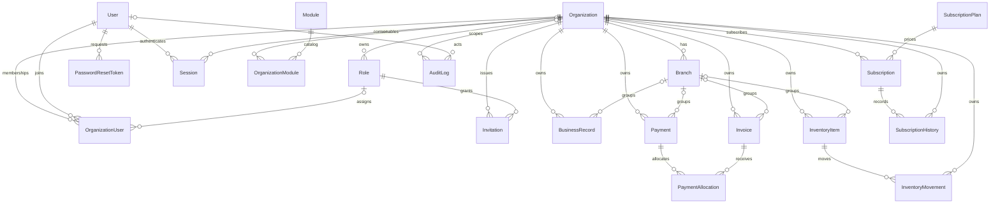
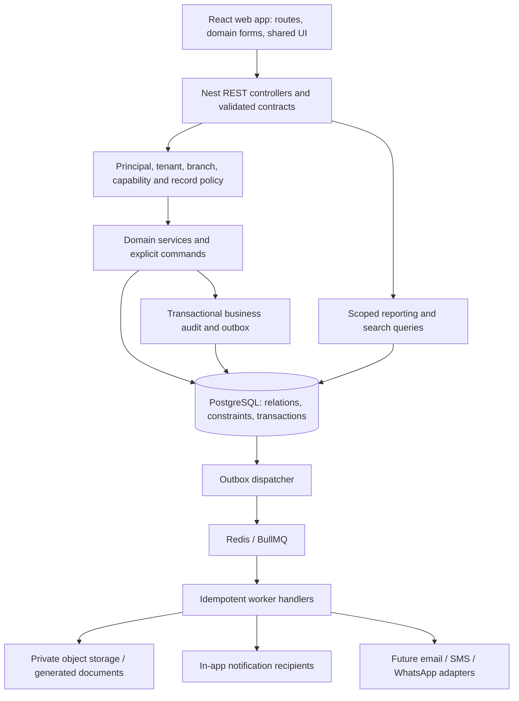

# OPERIX SYSTEM AUDIT

Audit date: **2026-09-30**. Workspace: `F:\Projects\Operix`.

**Verified update — 2026-10-02:** [Section 26](#26-p0-implementation-and-verification--2026-10-02) supersedes the original P0 findings where explicitly stated. Sections 1–25 retain the original audit evidence and roadmap; their original commands, counts and defect descriptions describe the September 30 baseline. This update verifies backend fixes, not completion of entire product modules or production readiness.

Scope: existing implementation, local execution, database integrity, security, product coverage, and a production-readiness plan. This is an audit, not a feature implementation or redesign. Application source, dependency manifests, migrations, and environment files were not changed. Builds regenerated their normal output. Temporary test tenants and their records were removed after API verification.

Evidence labels used throughout:

- **Runtime verified**: exercised against the running local API/database or through a repository command.
- **Source verified**: traced through the actual imported components, controllers, services, schema, or configuration.
- **Unverified**: not exercised; a plausible implementation or a comment is not proof of working behavior.

The supplied request ends at item “25. Recommended”. Section 25 therefore supplies a recommended implementation sequence and release gates. Historical requirements in `promp.md` are treated as product context, not evidence of implementation.

## 1. Executive Summary

**Operix is a substantial prototype with a usable technical foundation, but it is not ready to hold authoritative business, financial, personnel, or stock records in production.** Preserve and extend the React/Vite client, NestJS API, PostgreSQL/Prisma database, permission catalog, and existing tests. A wholesale rewrite is not justified.

The repository reconstructs a coherent product vision: a shared operating system for GHT's digital services, printing/production, installations, people, and field operations, with organization and branch boundaries and eventual commercial SaaS use. It already goes beyond a static dashboard: authentication, tenant membership, generic record persistence, payment recording/verification, stock movements, project-start gating, attendance, and subscriptions have server implementations. However, broad product vocabulary greatly exceeds actual domain behavior.

The most important findings are:

1. **Screens frequently address the wrong domain.** Finance loads `expenses`, Inventory loads `services`, Procurement loads `purchase-orders`, and Security loads `incidents` regardless of most selected tabs. The frontend does not call the dedicated finance or inventory command APIs. Generic rows and static statistics create the appearance of complete modules.
2. **Tenant checks work in the tested basic cases, but authorization is incomplete.** Cross-tenant record reads were denied. Within a tenant, branch and assignment restrictions were bypassed; permission overrides and module disablement were ignored. A company administrator without `employees.view_sensitive` received banking data. Employee notification reads were not recipient scoped.
3. **Financial integrity fails under normal API inputs and concurrency.** An EUR payment was verified against a USD invoice. Negative allocation amounts were accepted and reduced invoice paid balance. Eight simultaneous payments of 20 against an invoice of 100 all verified, while the stored paid amount was only 20.
4. **Inventory transactions are not concurrency safe.** Starting from quantity 10, eight simultaneous issues of 2 all succeeded; eight movement rows existed but the balance was 6. Negative purchase receipts also reduced stock.
5. **Workflow rules are bypassable.** The dedicated project-start endpoint rejected a missing contract, but a generic project PATCH set `IN_PROGRESS` successfully. Generic status updates also bypass archive permissions and do not synchronize `archivedAt`.
6. **MFA has a security defect.** Calling enrollment with an existing authenticated session resets the secret and disables already-enabled MFA without requiring the current factor or password. Password-only login then succeeds.
7. **The verification baseline is useful but inadequate.** Frontend build, backend build/typecheck, and 58 unit tests pass. The E2E script references a missing configuration file; lint executes zero tasks. Browser-based testing could not be performed because no browser was connected.

The immediate priority is to secure and make a narrow, truthful workflow reliable: **customer → project/quote → invoice → verified payment → receipt**, alongside controlled stock movements. Keep broader modules visible only to the degree that their actual behavior is understood; do not equate generic CRUD with a finished operational workflow.

## 2. Current Technology Stack

Versions below are from installed packages/build output in this checkout, not proposed upgrades.

| Layer | Current implementation | Implication |
|---|---|---|
| Web | React / React DOM **19.2.8**, JavaScript JSX | No frontend TypeScript checking |
| Web tooling | Vite **8.2.0**, `@vitejs/plugin-react` **6.0.5** installed | No Vite configuration file; React plugin is not explicitly configured |
| UI | `lucide-react` **1.28.0**, hand-written CSS, DM Sans from Google Fonts | Existing visual language can be retained; no component-library dependency |
| Client state | `useState`, `useEffect`, `useMemo`, a localStorage session wrapper, `fetch` | No router, server-state cache, central error boundary, or form framework |
| API | NestJS **11.1.28**, Express adapter, TypeScript | URI-versioned REST at `/api/v1` |
| Validation | Runtime `class-validator` **0.14.4** and `class-transformer`; shared Zod **3.25.76** schemas | Shared Zod domain schemas are not used by API handlers |
| Database | PostgreSQL 16 / PostGIS 3.4 image; Prisma client **6.19.3** | 20 models, 3 applied migrations |
| Auth | Nest JWT, Argon2 **0.41.1**, otplib v13 API | Password and refresh-token hashing; TOTP endpoints |
| Worker | BullMQ **5.81.3**, ioredis **5.11.1**, Redis 7 | One queue consumer; no API queue producers found |
| Storage/mail development | MinIO and Mailpit containers | Infrastructure exists; upload/mail delivery integrations do not |
| Backend workspace | pnpm **11.1.3**, Turbo **2.10.8**, TypeScript `^5.7.2` | Seven workspace packages; shared packages export compiled `dist` |
| Tests | Vitest **2.1.9**; Supertest installed | Seven test files, predominantly isolated/mocked tests |
| Environment used | Windows PowerShell, Node **24.18.0**, npm **12.0.0**, Docker CLI **29.6.2** | README's broad Node 20+ requirement is not a fully verified compatibility matrix |

Root dependencies use `latest`; the root `package-lock.json` pins this installation. Backend versions use ranges with `pnpm-lock.yaml`. Maintain both lockfiles until packaging is deliberately consolidated. Do not update everything to `latest` as a remediation strategy.

Sources: [root package](../package.json), [backend package](../backend/package.json), [API package](../backend/apps/api/package.json), [worker package](../backend/apps/worker/package.json), [TypeScript base](../backend/tsconfig.base.json).

## 3. Repository Architecture

```text
Operix/
  index.html                  active Vite entry
  package.json                active web application package
  src/
    main.jsx                  shell, navigation, live dashboard, disabled mock dashboard
    api.js                    fetch wrapper, refresh flow, localStorage session
    modules.jsx               module definitions, mock data, shared tables/forms/drawers
    UserManagement.jsx        directory and invitation creation UI
    experiences.jsx           marketing, login, invitation acceptance
    *.css                     existing responsive visual system
  frontend/
    web/                      empty directory
    mobile/                   empty directory
  public/                     empty directory
  design/*.png                design reference board, not an application
  backend/
    apps/api/src/             Nest auth, security, generic records, workflow controllers
    apps/worker/src/main.ts    BullMQ consumer
    packages/database/        Prisma schema, migrations, seed, client export
    packages/permissions/     module/permission/role catalogs and ability helper
    packages/validation/      extensive planned domain schemas
    packages/config/          environment/config contract, not wired into app boot
    packages/types/           domain constants, contexts, events, transport contracts
    infrastructure/docker/    local Postgres, Redis, MinIO, Mailpit
    docs/                     architecture/API/security descriptions
  docs/                       operational guides and this audit
  promp.md                    2,582-line historical product brief
  dist/                       generated frontend production bundle
  .tmp-workspace-api/          older generated frontend bundle
  node_modules/, .pnpm-store/  installed dependencies/cache
```

**There are not three independently implemented applications.** `src/` is the web application. `frontend/web` and `frontend/mobile` contain no implementation. `backend/` is a distinct workspace with API, worker, and shared libraries. The directory names match an intended future layout in the historical brief, but that intent does not make those clients exist.

The root HTML imports `/src/main.jsx`. No root `tsconfig`, Vite config, UI route files, custom hook directory, or service directory exists. The module UI is concentrated in a roughly 66 KB JSX file. Most backend business logic is in controllers, with a shared `ResourcesService` for JSON records.

`.tmp-workspace-api` contains compiled HTML/CSS/JS, including `index-CzjTUhul.js` and `index-CrZkcbcG.css`; it is not referenced by active scripts. It appears to be a prior generated snapshot, not a second maintainable frontend. Its exact provenance cannot be established. Do not delete it before deciding whether it is needed as an archival reference.

No applicable `AGENTS.md` was found. This provided workspace has **no `.git` repository**, so commit history, tracked-file status, provenance, and historical credential exposure cannot be verified. No CI workflow, production application Dockerfile, or infrastructure-as-code deployment was found. `design/` is ignored by the root `.gitignore`; confirm how that reference is preserved when restoring version control.

## 4. How the Application Currently Runs

### 4.1 Actual startup and environment

The frontend runs from the **repository root** with `npm run dev`. It defaults to Vite port 5173. The API starts from `backend/` with `pnpm api:dev` on port 4000; Swagger is `/docs`, health is `/api/v1/health`. The worker starts separately with `pnpm worker:dev`.

PostgreSQL is required for API startup because `DatabaseService.onModuleInit` calls `$connect()`. Redis is required for the worker. MinIO and Mailpit do not currently make application uploads or messaging work.

| Configuration | Actual runtime use |
|---|---|
| `VITE_API_URL` | Client API base; defaults to `http://localhost:4000/api/v1`. No active assignment found in root `.env` |
| `DATABASE_URL` | Used by Prisma/API; local target verified as `localhost:55432/operix` |
| `DATABASE_APP_URL` | Present for a low-privilege account but not selected by the API |
| `JWT_ACCESS_SECRET` | API JWT secret; insecure hardcoded fallback exists when absent |
| `NODE_ENV`, `PORT`, `CORS_ORIGINS` | Read directly by API startup |
| `APP_URL` | Invitation/reset links; current local value is `http://localhost:3000`, inconsistent with Vite at 5173 |
| `MFA_ISSUER` | TOTP issuer |
| `REDIS_URL` | Worker queue connection; fallback is localhost:6379 |
| `DEFAULT_GEOFENCE_RADIUS_M`, `GPS_MAX_ACCURACY_M` | Attendance constants, read during module evaluation; environment-load order needs correction |
| `PLATFORM_ADMIN_EMAIL`, `PLATFORM_ADMIN_PASSWORD`, `SEED_DEMO_DATA` | Seed behavior only; do not publish their values |
| JWT TTL/issuer/audience, refresh secret, password TTL/policy, rate limits, encryption, storage, mail/SMS/WhatsApp/push, PDF, maps, telemetry options | Mostly modeled in `@operix/config`, not operational merely because present in `.env.example` |

Backend `ConfigModule` searches `.env` and `../../.env` relative to the API process. Prisma package commands run with `backend/packages/database` as their current directory. Both local database URLs were verified to match. The worker does not explicitly load the shared config or root `.env`; its localhost Redis default masks that gap during this run. Deployment must inject and validate the worker environment.

For a **new disposable development database**, a corrected bootstrap sequence is:

```powershell
# From the repository root; preserve existing .env files.
npm ci
Set-Location backend
# If absent: create .env from .env.example and configure local values.
# Keep packages/database/.env aligned with the selected development database.
pnpm install --frozen-lockfile
pnpm infra:up
pnpm db:generate
pnpm build
pnpm db:deploy
# Only for a new disposable database; seeding resets existing seeded passwords.
pnpm db:seed
pnpm api:dev
```

Use a second terminal at the root for `npm run dev`, and a third in `backend/` for `pnpm worker:dev`. Shared package `dist` exports make the build step important on a fresh checkout; the README's abbreviated startup sequence assumes more prebuilt state than it acknowledges. This audit verified the already-installed dependencies rather than reinstalling or upgrading them. Existing migrations were up to date, so no migration or seed was applied.

### 4.2 Verification results

| Check | Observed result |
|---|---|
| `npm ls --depth=0` | Root installed dependencies resolved |
| `npm run build` | PASS; 1,788 modules transformed; JS bundle about 290 KB / 89 KB gzip |
| `pnpm test` | PASS after sandbox filesystem restriction was removed; 36 permission tests + 22 API tests |
| `pnpm typecheck` | PASS across backend workspace |
| `pnpm build` | PASS across seven packages; some Turbo tasks reused cache |
| `pnpm test:e2e` | FAIL: `backend/apps/api/vitest.e2e.config.ts` is missing |
| `pnpm lint` | No lint tasks executed; successful exit is not lint coverage |
| Prisma migration status | All three migrations applied; no pending migration |
| Docker services | Existing Postgres, Redis, MinIO, Mailpit became healthy after Docker Desktop was started |
| Frontend HTTP | `/`, transformed `main.jsx`, `modules.jsx`, and `experiences.jsx` returned 200 |
| API HTTP | Health returned `ok` / database `connected`; Swagger returned 200 |
| Registered API surface | Swagger contained **39 paths / 46 HTTP operations** |
| CORS/headers | localhost:5173 received allow-origin; an unrelated origin did not; Helmet `nosniff` observed |
| Worker | Started; Redis reported one worker, no queued/active/failed/completed jobs |
| Frontend package audit | Registry audit reported zero vulnerabilities at audit time |
| Backend package audit | Registry audit reported 31 findings: 1 critical, 17 high, 12 moderate, 1 low; see §16 |
| Browser, console, visual/mobile/keyboard testing | **UNVERIFIED**: browser runtime discovery returned no connected browser |

Sandbox-only pnpm cache access initially failed. Running the authorized checks outside that restriction allowed tests/builds to complete; this is not classified as an application failure. Package audit output was saved by PowerShell as UTF-16 and decoded accordingly; the registry results above are from the decoded responses.

No browser console or interactive UI action is claimed as runtime verified. Fetching compiled JSX and HTML establishes serving/compilation, not rendered usability. UI action failures in this audit are source-traced unless expressly identified otherwise.

### 4.3 Local API/database evidence

The baseline local database contained four organizations, 25 users, 15 business records, one inventory item, one invoice, and one payment. Tests used new temporary tenants, users, branches, and records with generated credentials. They did not alter the existing organizations' business records. Cleanup verified zero remaining fixture organizations and users; an independent final query confirmed all six baseline counts were unchanged. Audit scripts/results are in ignored `tmp/operix-audit/`; the significant results are reproduced here so the report stands alone.

| Test | Observed behavior |
|---|---|
| Generic customer CRUD | Create 201, persisted detail 200, update 200, search/pagination returned expected row, archive 200, subsequent detail 404 |
| Anonymous / basic role protection | Anonymous read 401; viewer customer creation 403; employee HR/invoice access 403; ordinary owner platform access 403 |
| Cross-tenant boundary | Changing organization header without membership returned 403; foreign customer ID returned 404 |
| Branch boundary | Restricted viewer read and listed a customer in another branch, both 200 |
| Foreign branch relation | Customer/invoice creation accepted a branch belonging to another tenant |
| Overrides/module enablement | Deny override, including helper-style array form, and disabled CRM module did not block reads |
| Employee field protection | Administrator without `employees.view_sensitive` received test banking data |
| Assignment / notification recipients | Employee read another user's assigned task and private notification |
| Contract gate | `/projects/:id/start` returned 400; PATCH of the same project to `IN_PROGRESS` returned 200 |
| Archive controls | DELETE denied with 403; ordinary update set `ARCHIVED` with 200 while `archivedAt` remained null and the record stayed readable |
| Invalid domain state | Updating a record to `WON` returned 500 with Prisma details, not a validation 400 |
| Normal payment | Recording and verification succeeded; invoice paid amount persisted; sequential repeat verification rejected |
| Currency mismatch | EUR payment allocated to USD invoice was recorded and verified |
| Negative allocation | Allocation of -5 was verified and lowered paid amount from 30 to 25 |
| Missing customer | Invoice accepted an arbitrary nonexistent customer UUID |
| Mixed totals | USD 100 + GNF 10,000 returned aggregate invoice total 10,100; verified USD/EUR payments were also summed |
| Financial visibility | Read-only user without finance permissions received finance totals via `reports.view` |
| Payment concurrency | Eight allocations of 20 against invoice total 100 all verified; invoice `paid` ended at 20 |
| Inventory | Sequential receipt worked; overdraw rejected; negative purchase receipt accepted |
| Inventory concurrency | Eight issues of 2 from starting stock 10 all succeeded; eight movements, final quantity 6 |
| Attendance | Normal check-in/out persisted; duplicate open shift rejected; low accuracy became pending; approval completed the shift |
| Pending attendance | Checked-out pending shift blocked next check-in and permitted repeated checkout until supervisor approval |
| MFA | Password-only login rejected when enabled; re-enrollment without reauthentication disabled MFA; password-only login then succeeded |
| Expired subscription | Reads allowed; business writes blocked; logout also blocked with 403 |
| Session lifecycle | Refresh rotated; old refresh rejected; logout revoked access and `/auth/me` returned 401 |
| Generic audit records | 34 successful-mutation log rows observed in first probe run; none had `before`, `after`, or structured `resourceId` |

Concurrency results are one bounded reproduction, not a load test or benchmark. They demonstrate violated invariants, not a measured failure probability.

## 5. Current Database Architecture

The database uses **20 Prisma models**, not a normalized table for every named product module. Most business domains share `BusinessRecord` with a `module`, `type`, status, and arbitrary JSON `data`. Finance, stock, identity, organizations, and subscriptions have dedicated models.

The following map represents declared Prisma foreign-key relationships. Dashed conceptual JSON links are described separately rather than depicted as enforced relationships.



Not enforced as relations: invoice/payment `customerId`, business-record project/customer/assignee/document IDs in JSON, inventory movement `referenceId`, most actor IDs, membership/invitation branch arrays, and subscription approval/history actors. `PaymentAllocation` has no own organization column. A branch/role foreign key proves existence, not that it belongs to the same organization as the referencing record.

Money is stored in `Decimal(18,2)` columns and stock in `Decimal(18,4)`. This is a useful base, but request DTOs accept JavaScript numbers, calculations sometimes use number arithmetic, and there is no currency-specific posting precision or exchange-rate model. `BusinessRecord.data` can also contain arbitrary floating-point financial values.

The three migrations are initial schema, password-reset/invitation tables, and subscriptions. Local migration status is current, which establishes migration history alignment, not a proof of zero schema drift. No row-level-security policy or immutable-ledger trigger is present. Runtime catalog inspection found zero RLS-enabled public tables. The API uses database owner `operix`, despite an `operix_app` role and `DATABASE_APP_URL` being supplied.

Sources: [schema](../backend/packages/database/prisma/schema.prisma), [migrations](../backend/packages/database/prisma/migrations), [database bootstrap](../backend/infrastructure/docker/init/01-extensions.sql), [database service](../backend/apps/api/src/platform/database.module.ts).

## 6. Authentication Architecture

1. Login validates email/password DTO, finds the user, checks active status and Argon2 password hash, then validates TOTP if enabled.
2. Only memberships in an `ACTIVE` organization are considered. Single membership resolves automatically; multiple memberships return workspace choices after credentials are proven. A `TRIAL` organization therefore cannot currently log in through this path.
3. Login creates a database session, stores an Argon2 hash of a random refresh secret, and signs a 15-minute JWT containing user/session IDs. Refresh tokens carry a session ID and secret. Session expiry is hardcoded to 30 days.
4. The browser stores the returned session, access token, refresh token, organization, and permissions in localStorage. A fetch wrapper retries a 401 after rotating refresh tokens.
5. Every protected request validates the access JWT and database session. Logout marks that session revoked.

Implemented foundations: password hashing, session revocation, rotating refresh, active-user checks on protected requests, hashed reset/invitation tokens, reset session invalidation, TOTP verification, and credential-gated workspace selection. Normal login/refresh/logout were runtime verified. Full reset, invitation, and TOTP-code enrollment workflows were source reviewed, not end-to-end browser tested.

Gaps:

- Login UI has no MFA-code input. “Forgot password”, “Remember me”, Google, and Microsoft controls do not implement their advertised behavior; no logout control is wired into the shell.
- `/auth/me` is used as a validity check, but its returned role/permissions/organization are not applied to React session state. Navigation can become stale after server-side changes.
- Concurrent 401 responses can rotate the same refresh token independently; no client single-flight refresh or server refresh compare-and-swap/reuse-family policy exists.
- Refresh itself does not check user status/membership; protected API requests subsequently do. A session is checked against its user but not against its stored organization, allowing a multi-member user's token to be reused across memberships by changing the header. Decide and document whether that is intended.
- Re-enrollment disables existing MFA without step-up authentication. TOTP secrets are stored as plaintext fields; no recovery codes, required-enrollment policy, or verified-MFA session state.
- Reset/invitation single-use state is read before a transaction rather than atomically claimed. Concurrent-use safety is unverified and structurally weak.
- Reset/invitation links are logged instead of delivered; the seed logs the seeded administrator password. No secrets are reproduced in this report.
- Rate limiting, failed-login lockout, and validated production-secret configuration are not connected to startup. No SSO integration exists.

Sources: [auth service](../backend/apps/api/src/auth/auth.service.ts), [auth controller](../backend/apps/api/src/auth/auth.controller.ts), [access guard](../backend/apps/api/src/security/access.guard.ts), [client API/session](../src/api.js), [public/auth UI](../src/experiences.jsx).

## 7. Authorization Architecture

The global `AccessGuard` checks the bearer token, organization header, current membership, user status, session, organization suspension, subscription restrictions, and `@RequirePermissions` metadata. Decorated requirements use exact permission keys and require all listed keys. Generic records instead use the controller's module/action permission map. The client independently filters navigation by permission strings.

This is a stronger base than UI-only role checks. Basic role and tenant denials were reproduced. However, `@operix/permissions` contains a much richer `buildAbility` helper with explicit denies, enabled modules, branch/data scopes, and customer/employee context, and **the API does not call it**. The guard reads `membership.role.permissions` directly.

Consequences:

- `permissionOverrides` and `OrganizationModule.enabled` do not affect access.
- Role `dataScope` metadata is neither persisted on `Role` nor loaded into the request context. `assigned`, `self`, `branch`, and `customer` are catalog intentions, not consistent query constraints.
- `branchIds` are checked only on generic record creation when a branch is supplied; generic list/get/update/archive do not enforce them. Finance, inventory, search, dashboards, project start, and supervisor attendance reads also lack consistent branch predicates.
- Reading generic JSON exposes all fields. `employees.view_sensitive` and per-document/per-notification visibility are not enforced by that serializer.
- Generic update permissions also allow arbitrary status transitions: quote approval, contract completion, project start, payroll stages, and archiving can bypass more specific capabilities.
- `/finance/summary` uses broad `reports.view`, not a financial-report permission.
- Invitation creation validates role tenant ownership but not whether the inviter may delegate that role or branch scope. Assigning a more privileged role needs an explicit delegation policy.
- Platform admin is implemented as a role on a tenant membership, not a separate principal/grant model. The guard treats **any** `platform.*` permission as a subscription exemption. Time-limited support grants described by comments do not exist.

Sources: [guard](../backend/apps/api/src/security/access.guard.ts), [resource authorization](../backend/apps/api/src/resources/resources.controller.ts), [resource queries](../backend/apps/api/src/resources/resources.service.ts), [unused ability policy](../backend/packages/permissions/src/ability.ts), [workspace queries](../backend/apps/api/src/platform/workspace.controller.ts).

## 8. Existing Modules

### 8.1 What the common workspace actually implements

`ModuleWorkspace` in [modules.jsx](../src/modules.jsx) owns the module tabs, statistics, search input, table, generic creation modal, and detail/edit drawer. `recordRow` renders `record.data.values`, not named customer/project/finance fields. Seeded records use named JSON fields, so their details can be present in the database but absent from table columns.

For mapped modules, list loads the first 100 records once per tab selection; local search filters that result. Create persists name, optional number, description, and presentation-oriented `values`. It ignores the form's status selection. An empty number stays empty despite “Generated if blank”. Edit persists name, arbitrary `RecordStatus`, and merged description. Archive calls the generic DELETE endpoint without a confirmation dialog.

All tabs of a module generally reuse its same `resourceModules` entry; they do not filter by `type`. The generic action label also remains the module-level label when the selected tab changes. The apparent breadth of screens is therefore not a breadth of working domain forms.

Statistics remain static for all these modules except loaded attendance. Tables show static sample rows until a live load succeeds; failed loads leave those samples visible alongside an error. Kanban and pipeline are always static. The drawer's activity timeline is static even for real records. Filters, Columns, Export, pagination, and top-level quick-create controls do not perform their advertised operations.

### 8.2 Screen/component and data inventory

All module screens are local React state under the same page, not separate routable URLs. `BR(x)` below means `BusinessRecord.module = x`. Exact capabilities appear in §10.

| Navigation / screens | Components and actual data/API | Working foundation and principal gap |
|---|---|---|
| Dashboard | `App`, `LiveDashboard`, `Panel`; `/workspace/dashboard`; BR, Invoice, Payment, InventoryItem, AuditLog | Real counters and recent audit entries; static date selector, mixed currencies, no reporting charts or refresh after mutations |
| CRM: Customers, Leads, Pipeline, Activities | `ModuleWorkspace`, `PipelineView`; **all tabular tabs → BR(customers)** | Customer generic CRUD; Leads/Activities load customers; pipeline is hardcoded; no contacts/profile history/conversion |
| Sales: Quotations, Proposals, Approvals, Services catalog | Shared workspace; **all → BR(quotations)** | Quote metadata CRUD; no line editor/pricing/send/approval/conversion/PDF; service catalog tab is not wired to services |
| Projects: All projects, Kanban, Tasks, Milestones, Files, Client approvals | Shared workspace and `KanbanView`; **tabular tabs → BR(projects)**; dedicated `/projects/:id/start` exists separately | Project metadata CRUD; tasks/milestones/files/approvals show project rows; no workspace relations; start command not called from UI |
| Contracts: All contracts, Templates, Awaiting signature, Versions, Approvals | Shared workspace; **all → BR(contracts)** | Metadata CRUD; completed contracts can satisfy backend gate; no signature/version/payment-schedule lifecycle |
| Finance: Invoices, Payments, Receipts, Customer balances, Expenses, Refunds, Reports | Shared workspace; **all → BR(expenses)** | Expense metadata CRUD; “Record payment” creates an expense record; dedicated invoice/payment tables are disconnected from UI |
| Inventory: Overview, Items, Rolls, Sheets, Movements, Material usage, Waste, Low stock | Shared workspace; **all → BR(services)** | Item/movement API exists separately; inventory UI can create services or fail permission checks; no real stock display |
| HR: Employees, Departments, Leave, Performance, Documents | Shared workspace; **all → BR(employees)** | Employee metadata CRUD; no department/leave/profile/document integration; sensitive JSON fields unmasked |
| Payroll: Dashboard, Payroll periods, Payroll run, Approvals, Payslips, Loans, Advances, Reimbursements | Shared workspace; **all → BR(payroll-runs)** | Run metadata only; no computation, locking, pay, payslips, or attendance consumption |
| Attendance: Today, Timesheets, Schedules, Adjustments, Attendance map | Shared workspace, `attendanceRow`, `LocationFix`; `/attendance` or `/attendance/mine`; BR(attendance/geofences) | GPS check-in/out, duration, location detail; tabs reuse shift list without their advertised date/schedule semantics; no approval button |
| Security: Guard dashboard, Shifts, Geofences, Patrol routes, Live patrols, Checkpoints, Incidents, Visitors | Shared workspace; **all → BR(incidents)** | Incident metadata CRUD; generic backend resources for fences/patrols/checkpoints/visitors exist but these tabs do not use them |
| Assets: All assets, Assignments, Maintenance, Categories | Shared workspace; **all → BR(assets)** | Asset metadata CRUD; no assignment history, maintenance workflow, depreciation, or category table |
| Work Orders: All work orders, Production queue, Quality control, Deliveries, Calendar | Shared workspace; **all → BR(work-orders)** | Metadata CRUD; no QC checks, delivery confirmation, calendar scheduling, or material effects |
| Production: Queue, Schedule, Machines, Quality control, Material usage, Waste | Shared workspace; **all → BR(production-jobs)** | Metadata CRUD; no machine scheduling, stages, stock consumption, or cost linkage |
| Procurement: Suppliers, Purchase requests, Purchase orders, Receiving, Supplier payments | Shared workspace; **all → BR(purchase-orders)** | Purchase order metadata CRUD; suppliers/requests have generic APIs but no correct tab binding; receiving has no stock effect |
| Customer Portal: Portal users, Quotations, Contracts, Projects, Invoices, Payments, Files, Messages, Support | Shared workspace; **all → BR(documents)** | No external-customer authorization/data model or working portal. Customer role has portal capabilities but not documents permission; permitted navigation can lead to failed loads/sample data |
| Notifications: All notifications, Templates, Delivery history, Preferences, Channels | Shared workspace; **all → BR(notifications)**; worker `notification.send` | Manual generic record CRUD; no recipient inbox/read state, trigger producer, provider delivery, or actual delivery statistics |
| Platform Admin: Overview, Organizations, Subscriptions, Plans, Modules, Support access, System health, Security events | Shared workspace; **no resource mapping** | Static screen; “Add organization” sends no valid module. Plan/subscription API exists but is not connected |
| Reports: Dashboard, Report builder, Saved reports, Export center | Shared workspace; **all → BR(reports)** | Report metadata CRUD; no query engine, generated report artifact, scheduler, or download |
| Settings | **`UserManagement`**, not `ModuleWorkspace` | User/role/branch reads and invitation creation; no user edit/revoke, custom role editor, company settings form, numbering, locale, or branch management UI |
| Public website, login, invitation acceptance | `PublicSite`, `AuthScreen`, `InviteScreen` in `experiences.jsx` | Login/invite API wiring; commercial links/claims and trial calls to action exceed implemented product |

The unused Settings definition in `modules.jsx` contains Organization, Branches, Users, Roles, Permissions, Modules, Notifications, Documents, and Audit log tabs. It is **unreachable from the current shell**, which mounts `UserManagement` instead. Treat it as prototype material, not a second working settings system.

## 9. Existing Routes

### 9.1 Frontend routes and navigation

| URL/state | Current behavior |
|---|---|
| `/` | Public marketing page when no session; app when saved session is accepted |
| `/#website` | Public experience selected at initialization or by explicit shell control |
| `/#app` | Written after login; does not encode module, tab, or record |
| `/?invite=<token>#website` | Invitation acceptance screen within `PublicSite` |
| `#features`, `#modules`, `#security`, `#contact` | Existing marketing anchors |
| `#industries`, `#pricing` | Navigation links have no corresponding rendered sections |
| `/reset-password?token=...` | Generated by backend; **no corresponding client reset screen** |
| CRM/Projects/etc. | `active` component state; no `/customers`, `/projects/:id`, or similar router |
| Record details | Drawer state only; cannot bookmark/share a direct record URL |

There is no router or general `hashchange` handler. A refresh loses the current module/tab/drawer. Browser Back/Forward cannot reliably navigate business records. Global search changes only the module selection, discarding the matched record ID, despite the “Opened ...” toast. Tasks can route to Projects without opening the correct task tab or record. Employee `tasks.view` can coexist with no Projects navigation because the shell checks `projects.view`.

### 9.2 Server surfaces

`/api/v1/*` contains the 46 registered operations below. `/docs` and `/docs-json` expose Swagger outside that prefix. There is no actual portal router, document-download router, WebSocket server, OAuth callback, or offline synchronization endpoint. Vite's history fallback serving a URL does not mean the application implements that route.

## 10. Existing API Endpoints

All business endpoints below have prefix **`/api/v1`**. “Authenticated” means the global guard applies, including membership/session/subscription checks; it does not imply record scope is correct. Public routes bypass the guard.

### 10.1 Auth, platform, organization, and workspace

| Method | Path | Authorization | Implemented behavior / limitation |
|---|---|---|---|
| GET | `/health` | Public | Database probe; returns a body with degraded state but no explicit 503 |
| POST | `/auth/login` | Public | Credentials, optional MFA, organization resolution, token/session creation |
| POST | `/auth/refresh` | Public | Rotates stored refresh hash |
| POST | `/auth/logout` | Authenticated | Revokes current session; incorrectly blocked by expired-subscription write restriction |
| GET | `/auth/me` | Authenticated | Current membership, user projection, role, organization |
| POST | `/auth/forgot-password` | Public | Stores hashed expiring token; logs URL; no delivery |
| POST | `/auth/reset-password` | Public | Updates password, marks token used, revokes sessions |
| POST | `/auth/invitations/accept` | Public | Creates/reuses user and upserts role/branches on membership |
| POST | `/auth/mfa/enroll` | Authenticated | Returns new secret/URI; unsafe reset of already-enabled MFA |
| POST | `/auth/mfa/confirm` | Authenticated | Verifies code and enables MFA |
| POST | `/auth/mfa/disable` | Authenticated | Password plus code when enabled |
| GET | `/organization` | Authenticated, no additional capability | Organization, every branch, enabled-module records |
| PATCH | `/organization` | `settings.manage` | Whitelists name/timezone/defaultCurrency/settings, but body has no DTO validation |
| POST | `/organization/branches` | `settings.manage` | Creates branch; minimal string validation |
| GET | `/organization/users` | `users.manage` | Memberships and safe user projection |
| GET | `/organization/roles` | `roles.manage` | Role list; no role create/update/delete |
| GET | `/organization/audit` | `audit.view` | Latest 100 audit rows, no pagination/filtering |
| POST | `/organization/invitations` | `users.manage` | Validates role belongs to tenant, creates/returns/logs invitation link |
| GET | `/organization/invitations` | `users.manage` | Unaccepted/unrevoked rows, including token hashes; expired entries are not excluded |
| GET | `/workspace/dashboard` | Authenticated + per-metric checks | Record counts, financial aggregates, recent audit activity |
| GET | `/workspace/search` | Authenticated + module read checks | Name/number search across 12 BR modules; min 2 characters, limit 20 |
| GET | `/platform/plans` | `platform.plans.manage` | Global plan list |
| POST | `/platform/plans` | `platform.plans.manage` | Upsert plan by key |
| GET | `/platform/subscriptions` | `platform.subscriptions.manage` | Global subscriptions with organization/plan |
| POST | `/platform/subscriptions` | `platform.subscriptions.manage` | Creates subscription, pricing snapshot, history and audit transaction |
| PATCH | `/platform/subscriptions/:id` | `platform.subscriptions.manage` | ACTIVATE / EXTEND / SUSPEND / REACTIVATE / CANCEL |
| GET | `/platform/subscriptions/:id/history` | `platform.subscriptions.manage` | History for global subscription ID |

### 10.2 Generic records

| Method | Path | Behavior |
|---|---|---|
| GET | `/records/:module` | List; `page`, `limit` (max 100), `status`, `search`; sorts created time descending |
| GET | `/records/:module/:id` | Non-archived detail by tenant, module, and ID |
| POST | `/records` | Body: module/type/name, optional number/branch/data; database status defaults to DRAFT |
| PATCH | `/records/:module/:id` | Name/status/data; JSON is replaced at API level; no domain-transition policy |
| DELETE | `/records/:module/:id` | Soft archive with status and timestamp |

Authorization map for all **25 admitted resource modules**:

| Module | Read | Create | Update | Archive |
|---|---|---|---|---|
| customers | customers.view | customers.create | customers.update | customers.archive |
| leads | leads.view | leads.create | leads.update | leads.archive |
| services | services.view | services.manage | services.manage | services.manage |
| quotations | quotations.view | quotations.create | quotations.create | quotations.cancel |
| contracts | contracts.view | contracts.create | contracts.update | contracts.void |
| projects | projects.view | projects.create | projects.update | projects.archive |
| tasks | tasks.view | tasks.create | tasks.update | tasks.delete |
| work-orders | work_orders.view | work_orders.create | work_orders.update | work_orders.cancel |
| expenses | expenses.view | expenses.create | expenses.approve | expenses.approve |
| suppliers | suppliers.view | suppliers.manage | suppliers.manage | suppliers.manage |
| purchase-requests | purchase_requests.view | purchase_requests.create | purchase_requests.approve | purchase_requests.approve |
| purchase-orders | purchase_orders.view | purchase_orders.create | purchase_orders.create | purchase_orders.create |
| production-jobs | production.view | production.manage_queue | production.execute | production.manage_queue |
| employees | employees.view | employees.create | employees.update | employees.offboard |
| leave-requests | leave.view | leave.request | leave.approve | leave.approve |
| payroll-runs | payroll.view | payroll.process | payroll.review | payroll.lock |
| geofences | attendance.view | security.geofences.manage | security.geofences.manage | security.geofences.manage |
| patrols | security.patrols.view | security.patrols.manage | security.patrols.manage | security.patrols.manage |
| checkpoints | security.patrols.view | security.patrols.manage | security.patrols.manage | security.patrols.manage |
| incidents | security.incidents.view | security.incidents.create | security.incidents.manage | security.incidents.manage |
| visitors | security.visitors.view | security.visitors.register | security.visitors.register | security.visitors.register |
| assets | assets.view | assets.manage | assets.manage | assets.dispose |
| documents | documents.view | documents.upload | documents.share | documents.archive |
| notifications | notifications.view | notifications.send_manual | notifications.manage_routing | notifications.manage_routing |
| reports | reports.view | reports.build | reports.build | reports.build |

`attendance` is deliberately not a generic allowed module; its records use the dedicated controller. Merely storing a `type` such as `templates` does not implement template semantics or permission separation.

### 10.3 Workflow endpoints

| Method | Path | Permission | Actual behavior |
|---|---|---|---|
| POST | `/finance/invoices` | invoices.create | Creates header from supplied subtotal/tax; adds them with JS arithmetic; no items |
| POST | `/finance/payments` | payments.record | Creates payment and allocations in transaction; verifies invoice tenant/customer, but not currency or positive nested amounts |
| POST | `/finance/payments/:id/verify` | payments.verify | Applies allocations and marks verified; sequential overpayment check, concurrency defect |
| GET | `/finance/summary` | reports.view | Totals/counts across all currencies; no date/branch filtering |
| GET | `/inventory/items` | inventory.view | Tenant items, optional `lowStock=true`; no pagination |
| POST | `/inventory/items` | inventory.receive | Creates zero-quantity item |
| POST | `/inventory/items/:id/movements` | inventory.adjust | Updates balance and writes movement; sign/concurrency/transfer/reservation gaps |
| POST | `/projects/:id/start` | projects.change_status | Checks completed linked contract or reasoned override; no generic-update protection |
| POST | `/attendance/check-in` | attendance.check_in | GPS, open-shift check, first membership branch, optional geofence flag |
| POST | `/attendance/:id/check-out` | attendance.check_in | Own shift duration and checkout; pending lifecycle defect |
| POST | `/attendance/:id/approve` | attendance.approve | Clears pending flag; no branch/supervisor assignment constraint |
| GET | `/attendance/mine` | attendance.view_own | Latest 50 own shifts with user/location enrichment |
| GET | `/attendance` | attendance.view | Latest 250 tenant shifts with enrichment |
| GET | `/attendance/pending` | attendance.view | Latest 100 pending tenant shifts; no enriched location projection |

Not present: invoice/payment list/detail endpoints; receipt/PDF endpoints; financial reversal/refund/credit commands; stock movement history endpoint; purchase receiving; quote conversion; contract signatures; role/user mutations; upload/presign/download; mark-notification-read; report jobs/downloads; QR scan/assignment validation; organization onboarding; support grants. Do not invent those endpoints in the client before implementing their actual contract.

Sources: controllers under [API source](../backend/apps/api/src), plus runtime Swagger route count. DTOs lack full Swagger property/response annotations; a visible Swagger route is not a complete API contract.

## 11. Feature Matrix

Classification is for the named capability, not merely whether a table or page exists:

- **COMPLETE**: end-to-end behavior, permissions, persistence, errors, and essential integrity are verified for the stated scope.
- **PARTIAL**: usable implementation exists but substantial requirements remain.
- **UI ONLY**: layout or interaction without its advertised backend behavior.
- **BACKEND ONLY**: server persistence/commands exist without a functioning matching UI.
- **BROKEN**: advertised or connected flow has an identified functional/security/integrity failure.
- **MISSING**: no executing implementation; schema constants or design mockups alone do not count. This includes placeholders in the broader request's vocabulary.

No entire target business module meets COMPLETE on current evidence.

| Target capability | Classification | Existing truth, gaps, and debt |
|---|---|---|
| A. Executive dashboard | PARTIAL | Live permission-filtered counters and audit feed; wrong currency aggregates, no time filters, expense/profit/overdue metrics or live charts; refresh only on session organization change |
| B. CRM/customers | PARTIAL | BR(customers) generic CRUD; contact data can persist in JSON but UI lacks typed fields, profile sections, contacts, history and deduplication |
| C. Leads | BACKEND ONLY | BR(leads) CRUD and unused lead schemas; Leads tab loads customers; no next-follow-up actions, conversion or qualified pipeline |
| C. Sales pipeline visualization | UI ONLY | Static `PipelineView`; no stage mutations, probability or won conversion |
| D. Quotations/proposals | PARTIAL | BR(quotations) metadata CRUD; no item math, currency-safe total, expiry, approval/send, PDF or conversion |
| E. Contracts | PARTIAL | BR(contracts), project JSON link and completed-state gate; no executed-signature evidence, immutable versions, approval/payment schedule or expiration alerts |
| F. Project management | PARTIAL | BR(projects) CRUD plus start command; gate bypassable, project tab relations absent, budget/progress manually stored, no typed workspace |
| G. Tasks | BACKEND ONLY | BR(tasks) CRUD; Projects Tasks tab loads projects; assignee/self scope missing, no comments/attachments/due views |
| H. Invoices | BROKEN | Invoice table and create command; no items or customer FK; UI loads expenses; no invoice list/update/send/overdue behavior |
| H. Payments | BROKEN | Payment/Allocation tables and verify command; UI creates expenses; negative allocations, cross-currency verification and concurrent lost updates reproduced |
| H. Expenses | PARTIAL | BR(expenses) CRUD, approval permission on update; no amount/date/category form, workflow invariants, receipts or payable state |
| H. Balances/financial reporting | BROKEN | Cached paid field and aggregate endpoints exist; mixed currencies and failed concurrency invalidate authoritative balances |
| I. Receipts | UI ONLY | Table definition only; no Receipt table, issuance service, numbering, payment link, print or PDF |
| J. Inventory | BROKEN | InventoryItem/Movement and transactional commands exist; UI maps to services; stock under concurrency incorrect; movements lack usable history/semantics |
| K. Project materials | MISSING | Optional movement reference ID and sample material-usage tables; no verified issue/receipt/consumed/returned ledger or project cost integration |
| L. Suppliers / purchase requests | BACKEND ONLY | Generic resources exist; procurement tabs all load purchase orders; no linked order/request/receipt/payment workflow |
| L. Purchase orders | PARTIAL | BR(purchase-orders) metadata CRUD; no items, approval state machine, receiving or supplier payment |
| M. Employees | PARTIAL | BR(employees) CRUD and separate user directory; no employee-user relation, configurable departments/positions or proper sensitive field policy |
| N. Attendance | PARTIAL | Server time, GPS, check-in/out, flags and approval API; pending lifecycle defect, no approval UI/date filtering/schedule/late/absence/manual or QR flow |
| O. Guard operations | PARTIAL | Shared attendance and generic fence/patrol/checkpoint/visitor records; no Site/Shift/GuardAssignment model or secure scan/assignment flow; security tabs wrong |
| P. Incidents | PARTIAL | BR(incidents) CRUD; form lacks site/time/severity/photos/actions/review; JSON not validated against incident schema |
| Q. Document management | MISSING | Metadata can be placed in BR(documents), but no file-byte storage/upload/download/ACL workflow; MinIO alone is not document management |
| R. Notifications | PARTIAL | Generic records, event constants and worker stub; no recipient inbox/read state/producers/durable delivery; worker marks delivered without delivering |
| S. Activity/audit | PARTIAL | Generic successful-write interceptor and explicit project/subscription logs; best-effort, no general before/after or immutable storage, static drawer timeline |
| T. Reports | UI ONLY | Report definition records can persist; actual report computation, export and scheduling absent; worker returns placeholder result |
| U. Users / RBAC | PARTIAL | Memberships, explicit roles/capabilities, user list and invites; scope/override/module enforcement broken; no role editor or user lifecycle controls |
| V. Settings | PARTIAL | Organization JSON/branch API, user/invite UI; no company form, numbering, taxes, locale/notifications/custom roles interface |
| Global search | PARTIAL | Real tenant/module name-number search; no branch/assignment filter, invoices absent, selection does not open record |
| Multi-organization foundation | PARTIAL | Tenant IDs, memberships, per-tenant uniqueness, multiple seeded tenants; constraints and scope policy incomplete; no tenant onboarding or branch switcher |
| Multi-currency | BROKEN | Currency columns and decimal DB storage exist; posting/aggregation/UI violate currency boundaries; no FX model |
| French/English localization | MISSING | Locale constants/schemas only; hardcoded English UI, no translation catalogs or locale setting |
| Payroll | UI ONLY | Generic payroll-run metadata backend; no payroll calculations, accounting or payslips. Defer full payroll as requested |
| Assets, production, work orders | PARTIAL | Generic metadata CRUD; their distinct scheduling/assignment/QC/stock/delivery workflows are not implemented |
| Customer portal | BROKEN | UI navigates to documents without customer-scoped API or identity link; no external-user workflow |
| Subscription management | BACKEND ONLY | Plans, subscription/history tables and commands; state-machine/payment/grace rules incomplete; frontend remains static |
| Native mobile / offline | MISSING | Empty `frontend/mobile`; no application, service worker, offline replay or signed QR handler |
| Public site/auth UX | PARTIAL | Marketing/login/invitation components; dead links, no trial signup/SSO/reset/MFA UI; unsupported security/uptime claims |

## 12. Current User Roles

The canonical source has **217 permission keys**, **30 role definitions**, and **29 unique role keys**. `sales_manager` appears twice. There are two unique platform roles, 26 unique internal business roles, and one customer role. Seed role upserts by organization/name hide the duplicate; uniqueness tests do not check role keys/names.

The data scope column below describes catalog intent only; the running API does not consistently enforce it. Permissions are stored as string arrays in `Role`; one nullable role is assigned per organization membership. There is no `Permission` or membership-role join table.

| Key | Role | Declared data scope | Capabilities count |
|---|---|---|---:|
| platform_super_admin | Platform Super Admin | all, platform plane | 17 |
| platform_support_admin | Platform Support Admin | all, platform plane | 6 |
| company_owner | Company Owner | all | 189 |
| company_admin | Company Administrator | all | 181 |
| branch_manager | Branch Manager | branch | 75 |
| finance_manager | Finance Manager | all | 46 |
| accountant | Accountant | all | 23 |
| sales_manager | Sales Manager | all | 40 |
| sales_representative | Sales Representative | assigned | 31 |
| customer_service_agent | Customer Service Agent | branch | 20 |
| project_manager | Project Manager | assigned | 43 |
| designer | Designer | assigned | 16 |
| developer | Developer | assigned | 16 |
| marketing_manager | Marketing Manager | branch | 27 |
| production_manager | Production Manager | branch | 42 |
| printer_operator | Printer Operator | assigned | 19 |
| inventory_manager | Inventory Manager | branch | 32 |
| purchasing_officer | Purchasing Officer | branch | 25 |
| hr_manager | Human Resources Manager | all | 34 |
| payroll_manager | Payroll Manager | all | 20 |
| security_supervisor | Security Supervisor | branch | 31 |
| security_guard | Security Guard | self | 16 |
| technician | Technician | assigned | 21 |
| installer | Installer | assigned | 17 |
| driver | Driver | assigned | 13 |
| auditor | Auditor | all | 37 |
| readonly_user | Read-only User | branch | 16 |
| employee | Employee | self | 15 |
| customer | Customer | customer | 12 |

Company Owner excludes platform/portal permissions and impersonation. Company Administrator excludes several explicitly sensitive capabilities, but generic field/status behavior undermines those exclusions. `PROJECT_READ` includes `milestones.manage`, so the role advertised as read-only has a future write-capability hazard even though that endpoint is absent today.

The seed first creates the configured GHT administrator as an owner, then changes that membership to Platform Super Admin. That account is consequently not a normal GHT operations owner. Demo owner accounts belong to Atlas, not GHT; the development login form defaults to an Atlas demo account. Separate GHT tenant-owner and platform identities deliberately before rollout. Production seed prevention is advisory: the seed includes demos unless `SEED_DEMO_DATA` is exactly `false`, and can reset existing seed-account passwords.

Sources: [roles](../backend/packages/permissions/src/roles.ts), [permission catalog](../backend/packages/permissions/src/permissions.ts), [seed](../backend/packages/database/prisma/seed/index.ts), [demo guide](demo-accounts.md).

## 13. Current Database Entities

| Physical model | Business purpose and constraints | Current gap |
|---|---|---|
| Organization | Tenant, unique slug, currency, timezone, status, settings JSON | No validated settings contract; trial/archive policy inconsistent |
| Branch | Tenant branch, unique tenant/code | Cross-tenant reference prevention missing in referencing models |
| User | Globally unique email, password, status, MFA, profile names | No employee/customer identity relation; plaintext MFA secret |
| OrganizationUser | Unique organization/user, role, branch string array, overrides, owner flag | One role only; overrides ignored; no stored scope; arrays not foreign keys |
| Role | Tenant/name uniqueness, string permissions, system flag | No persisted key/dataScope; no API role maintenance or immutability enforcement |
| Session | User/optional org, refresh hash, expiry/revocation/device metadata | No refresh-family reuse detection, atomic rotation, or user-facing session management |
| PasswordResetToken | Unique token hash, expiry, usedAt | Atomic consume/race protection and real delivery absent |
| Invitation | Tenant/email/role/branch array, hashed token, expiry, acceptance/revocation | Delegation/branch scope and existing-user acceptance need hardening |
| Module | Global key catalog | Catalog/module disable flags not enforced by guard |
| OrganizationModule | Tenant/module uniqueness, enabled/config | No management UI/API, plan entitlement resolution absent |
| BusinessRecord | Tenant, optional branch, module/type/number/name/status/JSON/actors/archive | Most domain relations and invariants are untyped and unenforced |
| Invoice | Tenant/number unique, customer UUID, currency and monetary headers | No InvoiceItem, customer relation, lifecycle, rounding/numbering policy |
| Payment | Tenant/number unique, amount/currency/method/status/verification | No reversal/refund/receipt models; unconstrained customer/branch references |
| PaymentAllocation | Unique payment/invoice pair with amount | No positivity or currency/tenant composite constraints; concurrent application unsafe |
| InventoryItem | Tenant/code unique, decimal quantity/reserved/minimum/cost | Location/supplier/valuation lacking; reserved unused; seed sets quantity directly |
| InventoryMovement | Item/type/quantity/balance/reference/actor | No source/destination or issued-to linkage, DB immutability, or reconciliation guarantees |
| AuditLog | Optional tenant/user, action/resource/ID/before/after/metadata/IP | Most fields unused by interceptor; no DB append-only controls |
| SubscriptionPlan | Unique key, six-month price, 24-month discount | No effective-dated price versions, module limits/entitlements |
| Subscription | Tenant/plan/period/state/pricing/payment/date snapshots | Latest-created selection, lax transitions, no explicit billing ledger |
| SubscriptionHistory | Tenant/subscription/actor/state/details | Application append path only; no database immutability; actor not FK |

Virtual entities in `BusinessRecord`: customers, leads, services, quotations, contracts, projects, tasks, work orders, expenses, suppliers, purchase requests/orders, production jobs, employees, leave requests, payroll runs, geofences, patrols, checkpoints, incidents, visitors, assets, documents, notifications, reports, and dedicated attendance shifts. These are not 26 independent normalized domain models.

Absent physical models include Contact, ProjectMember, QuoteItem, InvoiceItem, Receipt, ProjectMaterial, PurchaseOrderItem/GoodsReceipt, Employee/User linkage, Site/Shift/GuardAssignment, DocumentVersion, NotificationRecipient, ExchangeRate, NumberSequence, and durable OutboxEvent. Add them by workflow priority, not all at once.

## 14. Broken Functionality

Priority: **P0** blocks trusted production use; **P1** blocks an intended core workflow; **P2** limits completeness/operability. These are audit priorities, not formal CVSS ratings.

| ID | Priority | Failure and reproduction/evidence | Required acceptance condition |
|---|---|---|---|
| AUTHZ-01 | P0 | Branch-restricted viewer reads other branch; employee reads another assignee's task; direct HTTP 200 | Enforce identical tenant/scope predicates on lists, details, writes, counts, search, exports and jobs; negative integration tests |
| AUTHZ-02 | P0 | Explicit deny and disabled module ignored; helper is unused | One effective-ability resolver governs live requests and capability responses |
| AUTHZ-03 | P0 | Administrator lacking sensitive HR permission receives banking JSON; employee reads another recipient's notification | Field projections and recipient/subject-level policies verified by HTTP tests |
| AUTHZ-04 | P0 | `reports.view` exposes finance summary without financial capability | Financial reports require explicit financial read permission and scope |
| FIN-01 | P0 | Negative allocations and mismatched currencies recorded/verified | Nested validation, positive allocation bounds, currency equality, customer/tenant/branch checks before write |
| FIN-02 | P0 | Eight concurrent payments all verify; 160 allocated, 20 stored paid against 100 invoice | Serialized/conditional posting, idempotency and reconciliation; paid equals valid ledger total at all times |
| INV-01 | P0 | Eight issues of 2 accepted from 10; final quantity 6 | Concurrency-safe stock posting rejects overdraw and leaves ledger/balance equal |
| FLOW-01 | P0 | Generic PATCH bypasses project contract gate and archive permission | Protected transitions only through domain commands; generic endpoint cannot mutate protected state |
| AUTH-01 | P0 | Existing MFA is disabled by enrollment without reauthentication | Re-enrollment preserves current factor until a validated replacement; requires fresh authentication |
| DATA-01 | P0 | Invoice accepts nonexistent customer; tenant record accepts foreign branch | Tenant-aware relation validation plus composite FK/constraint protection |
| UI-01 | P1 | Finance → expenses, Inventory → services, procurement/security/task tabs wrong | Every visible tab reads/writes its named domain and renders named fields |
| UI-02 | P1 | Sample rows remain after errors; fake stats/activity and success toasts | Real loading/error/empty states; no sample fallback in operational views; success only after actual operation |
| ATT-01 | P1 | Pending shift with checkout blocks next shift and can be checked out repeatedly | Separate work interval closure from approval; unique open shift and immutable completed timestamps |
| ATT-02 | P1 | Supervisor UI chooses first open shift from entire attendance list for its own checkout action | Self-action queries own open shift; approval UI uses supervisor scope; source verified, not browser tested |
| AUTH-02 | P1 | UI lacks MFA/reset/logout; current `APP_URL` links to wrong port | Sign-in, recovery, logout and MFA reachable and tested through UI; canonical app URL |
| SUB-01 | P1 | Expired workspace blocks logout; organization suspension blocks reads despite read-only documentation | Distinguish business writes from security/session actions; explicit lifecycle/access matrix |
| API-01 | P1 | Unknown `RecordStatus` returns 500 with Prisma internals | Validate enums/IDs/query inputs and return sanitized 4xx errors |
| FORM-01 | P1 | Status chosen on create is ignored; auto-number promise is false; meaningful domain fields absent | Domain-specific forms and server numbering, with persisted response verification |
| ADMIN-01 | P1 | Users/roles UI depends on three successful reads; roles endpoint requires an additional permission | Deliberate invite-role projection and delegation policy; predictable partial/error handling |
| SEARCH-01 | P2 | Search result changes module but does not open returned record ID | Direct record route, correct tab, and permission-scoped results |
| OPS-01 | P1 | Missing E2E config, zero lint tasks, no CI/deploy implementation | Reproducible fresh install, real checks and production deployment/restore rehearsal |

The normal payment and stock handlers do use Prisma transactions. The failure is not “no transactions”; it is read-modify-write logic without adequate concurrency control or immutable posting identities. Similarly, tenancy is not wholly absent: the tested outer tenant reads are protected while references and narrower scopes are not.

## 15. Duplicate / Legacy Code

- `frontend/web` and `frontend/mobile`: empty planned locations. Retain until a deliberate directory decision; do not mistake them for running clients.
- Root `dist` and `.tmp-workspace-api`: generated frontend artifacts. The latter is stale relative to active sources; no script references it. Exclude build artifacts from source ownership decisions.
- `main.jsx`: old dashboard helpers, datasets, chart/donut code, and JSX guarded by `false`. The live dashboard does **not** currently render those fake executive charts, but the dead implementation creates maintenance ambiguity.
- `modules.jsx`: active shell mixed with hundreds of lines of sample datasets, static module statistics, static board/pipeline and fake detail activity. This is not all dead code: samples are runtime fallback and must be addressed explicitly.
- Settings prototype in `modules.jsx`: bypassed by the live `UserManagement` branch in `main.jsx`.
- `sales_manager`: duplicate role definition with the same key/name; seed upsert and map construction conceal it.
- Two invitation DTO declarations and multiple parallel contract definitions: local controller DTOs versus shared Zod schemas/types. Examples include `organizationSlug` versus `organizationId`, one role versus `roleIds`, `dueAt` versus `dueDate`, generic uppercase status versus rich lowercase domain statuses, six/24-month plan versus monthly/annual schema.
- `@operix/config`, `@operix/validation`, and much of `@operix/types`: valuable design inventory, but disconnected from runtime. Their comments often claim behavior that is absent. Integrate reviewed contracts or retire them deliberately; do not label them implemented services.
- `docs/architecture.md` describes AWS/EC2/RDS/S3; `backend/docs/architecture.md` depicts a Cloudflare WAF/PostGIS target. Neither is an implemented production stack. Resolve the deployment decision before writing further conflicting guidance.

Without Git history it is not possible to prove which source was generated, copied, or previously deployed. Observed prototype characteristics are evidence of scaffolding, not proof of origin. Nothing in this category was deleted during the audit.

## 16. Security Concerns

### 16.1 Confirmed control failures

The P0 authorization, MFA, finance and reference-integrity defects in §14 are release blockers. The sensitive-data and notification probes used artificial values, not real personnel data. Exact source roots are [AccessGuard](../backend/apps/api/src/security/access.guard.ts), [ResourcesService](../backend/apps/api/src/resources/resources.service.ts), [auth service](../backend/apps/api/src/auth/auth.service.ts), and [finance controller](../backend/apps/api/src/workflows/finance.controller.ts).

### 16.2 Additional source-verified risks

| Area | Existing protection | Concern / required work |
|---|---|---|
| Passwords | Argon2 hashes; reset length minimum | Shared stronger password schema is unused; no bound on all password/token inputs, throttling, lockout or breached-password policy |
| Sessions | Short access JWT, DB session checks, refresh hash rotation | localStorage exposes both tokens to successful script injection; no refresh coordination/replay-family detection; JWT issuer/audience and configured TTLs not applied |
| MFA | TOTP challenge at login | Enrollment takeover flaw, plaintext secret, no recovery/required-enrollment/step-up model |
| Secrets/config | `.env` ignored; example settings provided | Startup ignores config schema and uses known JWT fallback. Local secret is a template value. Cannot determine past commits because Git metadata is absent |
| Logs | Structured-ish errors and selected audit entries | Raw reset/invite URLs and seed password logged; unexpected exception messages returned to clients; general request logging/correlation absent |
| CORS/CSRF | Explicit origin allowlist observed; bearer token is manually attached | CORS is not authorization. Current flow does not use ambient auth cookies; if refresh moves to cookies, add explicit CSRF/origin defenses |
| SQL injection | Prisma predicates; health query is a tagged constant | No dynamic raw-query concatenation found in application source. This does not certify all dependency behavior; invalid input still leaks DB errors |
| XSS | React text interpolation; no `dangerouslySetInnerHTML` found | Not browser tested; future rich text/templates/upload previews need sanitization and frontend CSP. API Helmet does not protect separately hosted frontend HTML |
| Uploads | Private MinIO bucket bootstrap | No upload endpoint currently exists, so upload security is unimplemented rather than “verified safe”. MIME/size/hash/scanning/presigning settings are dormant |
| Invitations / privilege delegation | Token hashing and tenant role lookup | Any `users.manage` caller can select a more privileged tenant role; branch membership not checked; existing-user acceptance mutates role without authenticated target-user confirmation |
| Auditing | Some explicit transactional logs | Global audit interceptor is fire-and-forget and suppresses failures; failures/denials/auth events not comprehensively recorded; storage not append-only |
| Database isolation | Application tenant predicates, low-privilege role bootstrap | API uses owner connection; no RLS policies; foreign-key existence does not enforce same tenant |
| Administrative access | Explicit `platform.*` endpoint permissions | No support grants/principal separation; plan/organization/subscription controls are incomplete; public Swagger exposure needs a production decision |
| Network/deployment | Local services work | Compose publishes DB/Redis/storage/mail on all host interfaces with development credentials; not a production deployment template |

Do not store live employee bank/identity data or confidential documents in generic record JSON until field and document access controls exist. This recommendation is grounded in the reproduced HR field exposure, not a hypothetical upload feature.

### 16.3 Dependency audit

Registry-backed scans on 2026-09-30 returned:

| Dependency tree | Critical | High | Moderate | Low | Total |
|---|---:|---:|---:|---:|---:|
| Root frontend lockfile | 0 | 0 | 0 | 0 | 0 |
| Backend workspace lockfile | 1 | 17 | 12 | 1 | 31 |

The critical finding is Vitest's UI-server arbitrary file read/execution advisory, [GHSA-5xrq-8626-4rwp](https://github.com/vitest-dev/vitest/security/advisories/GHSA-5xrq-8626-4rwp). The audit ran `vitest run`, not the affected UI-server mode; no exploitation was attempted. Development dependencies also include older transitive Vite/esbuild, fast-uri, nanoid, and brace-expansion findings. Non-development findings include js-yaml, deepmerge-ts, qs, and multer. Registry classification is not proof that each vulnerable code path is reachable in Operix; multer, for example, is transitive even though no upload handler is implemented.

Triage installed dependency paths and advisory conditions, upgrade compatible direct/transitive dependencies, regenerate lockfiles deliberately, and rerun unit/build/API regression checks. Do not apply `audit fix --force` blindly. A zero frontend scan does not establish overall application security. Full registry responses are retained locally in `tmp/operix-audit/`; no dependencies were changed.

## 17. Data Integrity Concerns

### 17.1 Finance and currency

- Invoice headers trust client subtotal/tax; no item ledger from which to derive totals. Customer IDs are arbitrary UUIDs. No issue/cancel/credit lifecycle restricts posting against inappropriate invoices.
- Payment allocation DTO only checks that allocations is an array. Nested IDs/amounts are not validated, and negative values can pass the sum check. Customer/tenant invoice validation exists, but currency equality and branch scope do not.
- Verification reads existing `paid`, computes a new value, and sets it. Concurrent transactions can all read the same old value, pass overpayment checks, overwrite one another and mark all payments verified. The reproduced result proves ledger/balance divergence.
- No reversal/refund/credit-note command or receipt issuance; enums mentioning those states are not financial logic. Verification can be performed by the recorder if their role grants both; any dual-control requirement must be explicit.
- Dashboard/summary aggregate different currencies, convert decimals to Number, and lack explicit FX basis. Login omits `defaultCurrency`, while dashboard formatting defaults to USD and rounds display to whole units.
- Seed writes invoice paid/status directly and uses `PARTIALLY_PAID`, while verification writes `PARTIAL`. Seed stock quantity has no matching opening movement. Seed records should also satisfy the intended ledger invariants.

### 17.2 Inventory and materials

- A transaction alone does not protect a stock read-modify-write race. There is no version predicate, row lock, serializable retry, or atomic bounded decrement.
- `INITIAL`, `PURCHASE_RECEIPT`, `RETURN`, and `ADJUSTMENT` accept signed quantities; other movement types subtract `abs(quantity)`. This allows a negative receipt and zero movements. Stored quantity sign is not a consistent movement-delta convention.
- `TRANSFER` subtracts without crediting a destination; `RESERVATION` reduces physical quantity without updating `reserved`. There is no reservation release or protected available-stock calculation.
- No warehouse/bin/location model, cost layers, item update/history API, material recipient, issued/consumed/returned reconciliation, or validated project/order references.
- Movement rows are not protected by database append-only controls. No balance reconstruction/reconciliation job exists.

### 17.3 Generic records and state

- One shared `RecordStatus` cannot express sales stages, quote acceptance/expiry, incident severity/review, invoice states, employee lifecycle, and project on-hold semantics coherently.
- Generic PATCH can replace all JSON, with no version check, typed relationship validation, or immutable protected fields. Two editors can overwrite changes.
- Status and `archivedAt` can disagree. Generic status changes circumvent archive-specific capabilities.
- Actor/reference UUIDs and branch arrays are not consistently foreign keys. Records can reference nonexistent customers/users/projects or another tenant's branch.
- A `COMPLETED` contract is treated as fully executed without signature/version evidence. The project-start controller applies any requirement to starting, even a requirement nominally intended for delivery/material issue; other actual operations do not enforce those gates.
- Audit logging is not atomic with most business writes, so a successful mutation can be unaudited. A method/path alone is not an explanatory business event.

### 17.4 Attendance and subscriptions

- Attendance uses server time, which is good. It trusts client GPS claims, chooses the first branch in membership rather than a verified assignment, and accepts good-accuracy fixes as active when no fence exists.
- Check-in/open-shift existence is not enforced by a unique constraint or transaction. Pending checkout and approval share status, causing the reproduced closure defect. Checkout GPS is recorded but not used to flag location/accuracy policy violations.
- Attendance enrichment recomputes against the current geofence, so changing a fence can change how historical presence is presented. Store the decision-time policy/fence snapshot for auditability.
- Subscription authorization picks the latest created subscription. A new pending/no-end-date subscription can supersede an expired one in access decisions. Trial/pending/expiring/grace semantics and renewal pricing are incomplete.
- ACTIVATE/REACTIVATE/EXTEND do not enforce a strict prior-state matrix, payment sufficiency, idempotency or concurrent transition controls. Repeated activation can extend a term again. Date changes do not consistently update purchased duration/pricing snapshots. Grace end is stored but not used as a distinct access transition.

## 18. UX Problems

The reference design board and current CSS already establish a navy sidebar, blue accent, white cards, compact tables, badges, drawers, and responsive breakpoints. Preserve that recognizable system while correcting behavior. A redesign would not resolve the core defects.

Source-verified UX issues:

1. Business users see fake metrics, sample fallback records and fabricated activity beside real records. Loading/error/empty states must never substitute business facts.
2. Actions claim success without producing a download, opening filters, changing columns, or creating a quick-create menu. Pagination/select-all are decorative; search covers only the loaded slice.
3. Generic forms omit the fields needed for almost every domain. Creating a payment/employee/item through a name-description form is not an operational workflow.
4. Repeated headings and one global date selector imply filtering that the API never receives. “Today” attendance includes historical shifts, not a today-scoped query.
5. Create/Edit/Archive actions are not consistently capability gated at control level, so allowed navigation can lead to predictable 403s. A create-only employee expense permission has no reachable Finance flow.
6. Error toasts disappear quickly; lists lack retry controls. An empty list suggests changing search even when there have never been records. `UserManagement` advises signing in with the seeded owner on generic errors, which is unsuitable product guidance.
7. No record URLs, browser history, saved filters, sorting, server pagination, or reliable record selection from global search.
8. No archive confirmation, undo/restore flow, dialog focus trap, Escape handling, dialog ARIA semantics, or keyboard equivalent for clickable table rows. Several icon-only buttons lack accessible names. These are source findings; contrast and screen-reader behavior were not measured.
9. Mobile CSS exists, including horizontal tables, but touch workflows, overflow, virtual keyboard, actual GPS permissions and accessible navigation were not browser tested. A phone mockup is not an implemented mobile application.
10. The public page advertises free trial, SSO-like sign-in controls, offline tools, AES-256 encryption, multi-region readiness and 99.99% uptime beyond demonstrable implementation. Pricing/Industries anchors and footer policy links are incomplete; “Request demo” only scrolls to another sign-in CTA.

Localization is constants-only. Introduce translation keys, locale-aware dates/numbers, explicit organization timezone, and French labels gradually. Preserve GHT's industry breadth; choose configurable project/service types rather than forcing software-development terminology onto printing or installations.

## 19. Technical Debt

| Debt | Why it matters | Recommended treatment |
|---|---|---|
| Large, compressed JSX/controllers/CSS | Domain logic and samples are difficult to review; changing one tab affects unrelated screens | Split by behavior/module as real workflows are integrated; format with agreed tooling |
| Three competing contract layers | UI, local DTOs, shared Zod/types disagree | Pick one validated API contract; derive client types/OpenAPI from it |
| Disconnected permission/config packages | Strong-looking tests/comments don't secure real requests | Wire one policy/config resolver and test through HTTP, not only helper unit tests |
| Controller-owned transaction logic | Policy, validation, financial math and persistence are mixed | Extract domain services/commands; keep controllers thin and repositories scoped |
| JSON `values` used as business fields | Display columns become accidental storage schema | Render named domain properties; migrate structured core fields out of JSON |
| Frontend `latest`, dual package managers | Clean installs/upgrades are hard to reason about | Pin supported versions; keep two lockfiles until a tested workspace consolidation |
| Root JS has no static checking | API/component contract mismatches survive builds | Incremental TypeScript in API client and feature boundaries, no full rewrite prerequisite |
| No real E2E/lint/CI | Passing unit tests miss the demonstrated authorization/concurrency defects | Add functioning release pipeline with real Postgres/Redis integration suites |
| Weak observability | No dependable request IDs, error redaction, worker metrics or domain delivery tracing | Structured logs, generated correlation IDs, readiness checks, alerting and job lifecycle metrics |
| Bare worker stubs | Marking delivery without transport confirmation corrupts notification truth | Transactional outbox, retries/idempotency, real artifacts and recipient state |
| Deployment docs exceed implementation | No repeatable deploy/rollback/restore proof | Implement one chosen target and rehearsal; do not treat cloud names as installed infrastructure |
| Seed mutates credentials / business balances | Rerun can reset accounts or reintroduce inconsistent truth | Explicit local-only seed mode and invariant-preserving fixtures |
| Missing Git history | No change attribution, rollback baseline or provenance | Restore/init legitimate repository context before production work; no synthetic history claims |

Existing tests cover permission catalog/helper semantics, basic resource tenant predicate, selected module permissions, project gate branches, geofence math, attendance check-in flags, and two subscription pricing examples. They do **not** test the HTTP guard, frontend workflows, actual transaction isolation, uploads, authentication races, payment/stock commands, or real tenancy/branch boundaries. Config/validation/worker test tasks permit no tests. Supertest being installed does not supply integration coverage.

## 20. Missing Product Features

The largest missing element is the **connected workflow**, not another navigation item. GHT cannot yet reliably trace a lead into a customer, quote, contract, project, invoice, collection, receipt, associated costs/materials, and resulting margin.

| Product area | Missing outcomes to implement when prioritized |
|---|---|
| Customer and sales history | Contacts, ownership, activities, follow-ups, pipeline stages, deduplication and conversion preserving identity |
| Commercial documents | Quote/invoice line items, discounts/taxes/rounding, approval, send/version snapshots, expiry and PDF/print |
| Contracts and delivery | Executed versions, signatures/approvals, schedules/deliverables, appropriate action-specific gates and expiration alerts |
| Projects and tasks | Real detail workspace, team/assignees, milestones/dependencies/comments/files, due/overdue views, computed progress and cost/margin |
| Finance | Invoice/payment browsing, allocation integrity, receipt numbering, reversals/refunds/credits, expense approvals, per-currency balances and reports |
| Stock and procurement | Location ledger, movement history, project issue/return/consumption, reservations/transfers, PO lines, receiving and supplier settlement |
| People | Employee-user linkage, departments/positions, protected documents, leave and policy-aware attendance; defer payroll engine |
| Guard operations | Sites, time-bounded assignments, shifts, authenticated QR/GPS validation, supervisor review and incident attachments |
| Shared platform | Real document service, recipient notifications, activity feed, direct search navigation, exports, configurable company identity/numbering/localization |
| Production operations | Machine/stage scheduling, QC, deliveries, material usage and waste linked to jobs/projects |
| SaaS later | Onboarding, secure customer portal, custom roles, support grants, entitlements and complete subscription lifecycle |
| Production delivery | CI/security checks, deployable images/configuration, secrets, monitoring, backup/restore, data import/reconciliation, user acceptance |

Do not prioritize payroll, native mobile, advanced SaaS billing, or external messaging ahead of a safe GHT operating core solely because their prototype tabs exist.

## 21. Recommended Target Architecture

### 21.1 Keep a modular monolith

Retain React/Vite, NestJS, Prisma/PostgreSQL, and a separate BullMQ worker. Introduce strong domain boundaries inside this system rather than creating microservices or replacing frameworks. Current defects arise primarily from disconnected policy, broad JSON mutation, weak workflow contracts, and missing UI integration.



Each mutation should follow the same order: authenticate → resolve tenant/policy → validate input and referenced records → apply domain transition within a transaction → write audit/outbox events → return a typed projection. Workers must carry organization/entity IDs and repeat authorization/ownership validation appropriate to the job. No tenant ID from an ordinary business request body becomes trusted context.

### 21.2 Domain truth and calculations

Keep core fields and relationships relational. Reserve JSON for validated extensible attributes such as print dimensions, installation details, or industry-specific project metadata. A configurable project type/service catalog should support websites, brands, printing, signage, maintenance, campaigns and other GHT services without adding a separate project table per industry.

Use decimal strings at API boundaries and decimal arithmetic through posting. Define supported currency codes, precision and rounding once. Preserve the existing Decimal database foundation; do not convert all money to floats or sum all currency columns into a default-currency card. An FX conversion, when needed, must name a base currency, rate, effective date/source, and rounding policy, and retain the original amount.

Recommended authoritative relationships:

- Invoice total derives from validated items, discounts and tax rules; persist an issued snapshot for reproducibility and reconcile cached totals against items.
- Invoice balance derives from posted invoice total, valid credits, and posted payment allocations/reversals in the same currency. Pending payments do not reduce it.
- Physical stock derives from signed posted movements per item/location; reservations are a separate availability claim. A cached balance is maintained under concurrency control and periodically reconciled.
- Project financial results derive from linked invoice/credit/payment/expense/material records. Present **cash collected**, **invoiced value**, and **estimated margin** as separate metrics with defined recognition/cost rules; do not call all payments “revenue”.
- Project progress derives from a declared task/milestone weighting policy, or is explicitly labeled manual with change history.

Posting operations need idempotency keys scoped by organization/command and concurrency control. For multi-row allocations, use serializable transactions with bounded conflict retries or carefully designed row locking/conditional updates; test the invariant, not just transaction completion. Prisma's v6 documentation specifically addresses isolation and retryable write conflicts. [Prisma v6 transactions](https://docs.prisma.io/docs/orm/v6/prisma-client/queries/transactions).

### 21.3 Frontend integration

Introduce a router and stable module/record URLs, a typed API layer and consistent server-state invalidation. Use a small set of shared Table, FormField, Dialog, Drawer, StatusBadge, Money, DateRange and state components, while keeping domain-specific forms and actions separate. Reuse the current CSS identity and layout patterns.

The server returns effective capabilities and allowed transitions; the UI uses them to guide users while the API rechecks every action. Fetch details by record ID, render named properties, and make loading/error/empty states honest. Integrate one module fully before copying its patterns. Incremental TypeScript conversion at the API and domain boundaries is preferable to an unrelated UI rewrite.

### 21.4 Documents, notifications, reporting and operations

Create one document service with metadata, parent-entity authorization, private object keys, staged upload, confirmation/content validation, malware quarantine where required, and expiring authorized downloads. Generated quotes/invoices/receipts reference immutable business versions. Do not embed file handling independently in every page.

Use transactional outbox events for in-app notifications first. Separate event, recipient, delivery attempt and read state. A notification is marked delivered only after its actual channel succeeds; report/document jobs finish only after an artifact exists. Add retry/backoff, deduplication and failure visibility. External channel adapters can then be added without changing financial/project domain logic.

Start reporting as indexed, scoped PostgreSQL queries with explicit date/timezone/currency filters. Materialized views or separate analytical storage should wait for measured scale. Search should share the same scopes and return entity-specific URLs, including financial documents once their APIs exist.

Choose and implement one deployment target from the existing competing docs. Package the API and worker separately, serve frontend assets over HTTPS, use private database/Redis/storage, managed secrets and automated backups, and verify restore. Add graceful shutdown, dependency readiness, structured logs/metrics and operational alarms. Cloud migration or multi-region deployment is not required to establish a safe GHT pilot.

## 22. Recommended Database Changes

### 22.1 Extend existing entities by priority

| Priority / change | Existing anchor | Proposed change and reason |
|---|---|---|
| P0 tenant references | Organization, Branch, Role, Invoice, Payment, BR | Add tenant-aware composite relation constraints where possible; validate all referenced IDs. Prevent foreign tenant branch/role/customer relations |
| P0 posting consistency | Invoice, Payment, Allocation, Item, Movement | Positive-amount checks, currency checks in domain transaction, posting/idempotency/version state, concurrency-safe cached balances; reconciliation queries |
| P0 identity policy | Role, OrganizationUser, User, Session | Persist stable role key/data scope; normalize overrides; define membership branch semantics; pending/active MFA secret separation; refresh concurrency/reuse state |
| P0 audit delivery | AuditLog | Transactional business events, before/after redacted field diffs, immutable append policy; outbox table with uniqueness and retry state |
| P1 customer/core project | BR(customers/projects/tasks) | Promote Customer, Contact, Project, ProjectMember, Task and milestone fields as delivered workflows require; preserve IDs and extension JSON |
| P1 sales documents | BR(quotations/contracts), Invoice | Quote/QuoteItem, InvoiceItem, numbered immutable document versions; customer/project FKs and explicit lifecycle states |
| P1 receipts/credits | Payment, Allocation, Invoice | Receipt tied to verified posting with unique number; reversal/credit records that preserve original transactions, not destructive edits |
| P1 stock/materials | Item, Movement | InventoryLocation, stock balance per location, reservations, paired transfers and ProjectMaterial/issue-return links; movement snapshot costs |
| P1 procurement | BR(suppliers/requests/orders) | Supplier, purchase order/items, goods receipt/items as receiving is implemented; receipt posts inventory atomically |
| P1 attendance | BR(attendance/geofences), User | Employee link, Attendance interval plus approval state, open-shift constraint and decision-time geofence snapshot |
| P1 shared files/events | BR(documents/notifications) | Document, version/link/grant metadata and NotificationRecipient/Delivery; parent ownership and recipient scope |
| P1 settings | Organization.settings | Versioned validated settings plus NumberSequence with atomic allocation; currency and locale policy |
| P2 field operations | BR(incidents/patrols/checkpoints) | Site, Shift, GuardAssignment, PatrolSession, scan evidence and incident linkage when actual field workflow is built |
| P2 HR structure | BR(employees/leave) | Configurable Department/Position/LeaveType and employee-user relation; protect sensitive fields; no premature payroll engine |
| P2 FX / SaaS | Currency columns / Subscription | Explicit ExchangeRate snapshots when conversion is needed; billing/entitlement history and support grants only with corresponding features |

Do not add a separate `Permission` table just to duplicate the versioned code catalog. Custom tenant roles can reference validated capability keys first. Likewise, do not create both a new normalized financial truth and an independently editable generic financial record.

### 22.2 Migration approach

1. Restore a version-control baseline and back up the current database. Inventory actual BR JSON shapes per tenant/module/type, missing references, invalid statuses and duplicate business identifiers.
2. Define authoritative field names/statuses and a migration mapping. Preserve existing UUIDs where possible; use an explicit old-to-new mapping when not. Report invalid data for review instead of silently inventing missing business facts.
3. Add nullable relational columns/tables, versions and indexes through migrations. Backfill in resumable, tenant-scoped batches with dry-run counts and checksums.
4. Validate customer/project/branch ownership and reconcile payment allocations/invoice paid values and stock movements/balances. Existing opening balances need explicit approved opening entries; do not fabricate historical movements.
5. Switch one domain's reads/writes to its new service. If temporary dual writes are unavoidable, make them transactional and reconciliation-backed with a scheduled cutover; otherwise use a compatibility read adapter and one writer.
6. Add NOT NULL, FK, check and uniqueness constraints after data passes validation. Use least-privilege runtime access and introduce tested PostgreSQL RLS as defense in depth, with transaction-scoped tenant context compatible with pooling and worker execution.
7. Retire the old generic write path for that domain, preserve historical/archive access, and document rollback. Delay destructive column/table removal until the compatibility period and verified restore checkpoint.

### 22.3 Candidate invariants and indexes

- Unique active organization/user membership, unique tenant document number/type/series, unique posting idempotency key, one open attendance interval per employee, and unique event/recipient delivery identity.
- Allocation amount > 0; item quantities/precision valid; posted movement immutable; transfer legs balance; pending/verified/reversed states have legal transitions.
- Same tenant on customer/project/branch/role/document relationships; currency equality on allocation unless explicit FX posting exists.
- Scoped indexes on tenant/branch/status/date, task assignee/due date, invoice customer/due date/currency, movement item/location/time, document entity linkage, notification recipient/read/time, and outbox state/next-attempt.
- Evaluate trigram/search indexes against query plans; the presence of `pg_trgm` alone does not accelerate current contains queries. Use GIN on JSON only for specific measured queries retained during migration.

## 23. Recommended Permission Architecture

Retain the existing capability vocabulary (`customers.view`, `payments.verify`, etc.) initially. A wholesale `.view` → `.read` rename has little benefit compared with enforcing the 217 keys already defined. Remove duplicates and verify catalog/role consistency in CI.

Resolve an immutable request principal containing user/session, organization, effective permissions, enabled modules, branch scope, data scope, employee/customer identity and verified authentication level. Persist enough role metadata to construct it. Adapt the existing `buildAbility` implementation after clarifying its branch-null/empty semantics; do not assume its current helper behavior alone is the final policy.

Recommended decision sequence:

1. Require valid authentication and an allowed organization lifecycle.
2. Resolve membership and permitted organization context on the server.
3. Apply explicit deny, module entitlement/enablement, approved overrides and role grants. Keep platform privileges separate from tenant grants.
4. Require the action capability and a valid domain transition.
5. Apply tenant plus branch/assigned/self/customer query scope; validate linked records with the same rules.
6. Apply field and document sensitivity policies before serialization or export.
7. Require step-up or separation of duties for policy-defined high-risk actions; write auditable outcomes.

Consistent least privilege and checking every request are supported by [OWASP's authorization guidance](https://cheatsheetseries.owasp.org/cheatsheets/Authorization_Cheat_Sheet.html). That is general guidance; the concrete branch/field/recipient findings here were independently reproduced in Operix.

| Example capability | Necessary scope and constraints |
|---|---|
| customers.view/update | Tenant + allowed branches or customer assignment; linked contacts obey same scope |
| tasks.view/update | Tenant + self/assigned/team scope; employees cannot edit another assignee's task |
| projects.change_status | Project scope + legal state transition + contract/deposit gates |
| quotations.approve / contracts.countersign | Explicit stage capability, immutable commercial version, no generic status bypass |
| payments.record / payments.verify / payments.reverse | Financial scope, currency/posting policy, idempotency and any required distinct approver |
| inventory.receive/issue/transfer/adjust | Relevant item/location scope and movement-specific capability; reason for adjustment |
| employees.view / employees.view_sensitive | Safe projection by default; sensitive data restricted independently of basic profile access |
| attendance.check_in / approve | Own active assignment for check-in; assigned team/site and approval policy for supervisors |
| documents.view/download/share | Parent entity plus confidentiality/share grant; possession of object key is not access |
| notifications.view | Intended recipient (or separately authorized support/admin view), not all tenant notifications |
| users.manage / roles.manage | Delegation ceiling, tenant-owned role/branches, owner protection and audit |
| platform.* | Explicit platform principal and action; tenant business access only through approved, time-bounded grant |

Membership with no branches should mean organization-wide only for a role explicitly allowed that scope. For a branch-scoped role, empty branches should not silently grant access. Define access to organization-level/null-branch records and whether mixed roles broaden scope; test that policy instead of relying on list order.

Protect changing an MFA factor with fresh proof of the existing factor or a controlled recovery process; an active session alone is insufficient. This directly addresses the enrollment defect and follows [OWASP's factor-change guidance](https://cheatsheetseries.owasp.org/cheatsheets/Multifactor_Authentication_Cheat_Sheet.html#changing-mfa-factors).

Test a permission matrix through the **real HTTP stack** for owner, administrator, finance, sales, project manager, inventory, HR, supervisor, employee, guard, viewer, customer and platform admin. Use at least two tenants and two branches, and cover list/detail/search/count/export/write/worker paths, field redaction, deny overrides, disabled modules, expired subscriptions, stale sessions and escalation attempts. Preserve the existing helper tests as a smaller unit layer.

## 24. Recommended Module Structure

The following is an incremental destination, not an instruction to move everything now. Keep the root frontend package initially; a later `frontend/web` move should be an isolated packaging change with startup/build verification.

```text
src/
  app/                 routes, shell, providers, session boundary
  shared/
    api/               typed client, refresh coordination, errors
    ui/                accessible tables/forms/dialogs/states
    money/             formatting and currency-aware display
    i18n/              English/French keys and locale selection
  features/
    dashboard/
    customers/         contacts, customer profile and activity
    sales/             leads, services, quotes and approvals
    contracts/
    projects/          projects, tasks, members and milestones
    finance/           invoices, payments, expenses, receipts
    inventory/         items, locations, movements, project materials
    procurement/
    people/            employee profiles, attendance and leave
    field-operations/  sites, assignments, incidents, patrols
    documents/
    notifications/
    reports/
    administration/    company, branches, users, roles, settings
    platform/          separately authorized SaaS controls
backend/apps/api/src/
  platform/            config, principal/policy, db, errors, health
  modules/
    <domain>/
      controller.ts    HTTP mapping and contract validation
      service.ts       domain commands, transitions, invariants
      repository.ts    consistently scoped persistence/query methods
      policy.ts        record/field/transition policy
      contract.ts      validated request/response definitions
backend/apps/worker/src/
  handlers/            document, report and notification jobs
  outbox/              dispatch, retry and deduplication
backend/packages/
  database/            authoritative relational model and migrations
  permissions/         catalog, role defaults and effective policy
  validation/          adopted API contracts; retire divergent copies
  types/               consumed contracts/domain constants
  config/              shared validated API/worker configuration
```

Avoid building a universal metadata form engine for finance, HR, attendance and inventory. Share presentation primitives, but let each domain own its inputs, allowed actions and errors. Keep generic records temporarily for low-risk notes, prototypes or genuinely extensible metadata; sensitive state transitions must not remain arbitrary CRUD.

Cross-domain links should be IDs with validated relationships. Notify/report/search/document modules consume those domain records and events, rather than copying a second editable financial/project truth. Keep GHT company details in organization settings and templates; brand identity in a shared shell can remain Operix while legal document identity varies by organization/branch.

## 25. Recommended Implementation Roadmap

### 25.1 Sequence and release gates

Effort estimates should be made after the initial safety work and a GHT workflow walkthrough; no delivery date is inferred from the presence of prototype pages. Use bounded increments with acceptance evidence.

| Phase | Deliverable and order | Dependencies | Exit gate |
|---|---|---|---|
| 0. Reproducible baseline | Recover version control; document real startup; pin supported tooling; preserve data backup; fix E2E/lint/CI scaffolding; create isolated integration fixtures | Audit | Fresh setup/build/test works; CI runs actual checks; backup restored in a disposable environment |
| 1. Security and correctness | Fix MFA enrollment, scoped authorization/fields/recipients, effective overrides/modules, secret validation and error redaction; block generic transition bypasses; make payments/stock concurrency safe; validate references | Phase 0 | All P0 probes now fail safely or produce correct balances; two-tenant/two-branch HTTP matrix passes; relevant dependency findings remediated/triaged |
| 2. Truthful operational UI | Correct every active tab's API mapping; replace fake fallback/stats/timelines; disable or label unfinished actions; wire real errors/loading; add direct record routes, capability-gated controls, auth recovery/MFA/logout | Phase 1 policy/contracts | Browser tests prove visible actions match their domain; denied users see correct UI and still receive server denial; no fabricated business data |
| 3. GHT commercial core | Customer/contact profile → lead/quote → contract/project → line-item invoice → payment allocation/verification → receipt; typed entities, numbering, currency-safe calculations and document snapshots | Phases 1–2, minimum shared document service | One full service order completed without duplicate entry; partial payment, cancellation/credit, role denial and per-currency balance examples reconcile |
| 4. Project delivery and procurement | Real tasks/team/milestones; stock history/locations; materials issue/return/consume; suppliers/PO lines/receiving; expenses tied to project; printing/installation details | Phase 3 customer/project IDs; safe stock engine | A printing or signage job and a digital project both complete; no stock imbalance; project cost/collections independently traceable |
| 5. People and field operations | Employee-user relation, configurable departments, attendance interval/approval fix, sites/shifts/assignments, supervisor view, incident attachment/review; QR only with authenticated assignment validation | Identity/scopes/documents; attendance migration | Multi-day and overnight shifts, pending reviews, site changes, denied assignments and replay attempts behave correctly |
| 6. Shared insight and usability | In-app notifications via outbox; actionable search; date/currency/branch-filtered dashboards/reports/export; English/French; responsive/accessibility acceptance | Reliable domain records/events | Metrics reconcile to drill-down records; notification is visible only to recipients; exports obey same scopes; mobile/keyboard tests pass |
| 7. Production pilot | Implement chosen hosting, secrets, TLS/private services, telemetry, backup/PITR/restore, data import and reconciliation, operational runbooks and GHT training | Relevant workflow phases and all release gates | Limited GHT users sign off on real workflows and recovery exercises; no open P0; no reliance on prototype controls |
| 8. Broader SaaS and optional modules | Custom roles, tenant onboarding, billing/entitlements/support grants, customer portal, external channels, advanced production, payroll or native/offline app according to demand | Stable GHT pilot and confirmed product need | Dedicated threat model, domain acceptance and operational support per new capability |

Phases are dependencies, not a mandate to wait until all of Phase 6 before piloting a much narrower safe scope. A pilot may include only delivered modules if every exposed workflow passes its gate and unfinished functionality is clearly unavailable.

### 25.2 First implementation backlog

Recommended first reviewable changes, in order:

1. Add real HTTP/PostgreSQL regression coverage for the reproduced defects; restore working E2E/lint commands and safe fixtures. Keep test data isolated from seeded operational/demo accounts.
2. Fix MFA re-enrollment and startup config validation; remove raw secret logging, sanitize internal errors, and rate-limit authentication. Verify the UI can actually complete MFA before requiring it for privileged users.
3. Introduce one request policy and scoped repository boundary; enforce overrides/modules/branch/assignment/field/recipient rules. Add tenant-safe foreign-reference checks and prevent privilege delegation above the caller's authority.
4. Move payment/stock mutations into explicit posting services with validated decimal inputs, currency checks, idempotency and concurrency protection; reconcile existing balances and ledger entries.
5. Reject generic lifecycle changes that bypass contract/approval/archive rules. Separate attendance closure from supervisor approval; exempt safe session/security actions from subscription write restrictions.
6. Correct the UI-to-domain mapping and remove fake operational state, without changing the established visual design. Connect customer/project screens as the first complete UI slice, then finance/inventory.

### 25.3 Acceptance scenarios before production

| Area | Required scenario |
|---|---|
| Identity | Login, multi-workspace choice, refresh race, revoked/suspended user, MFA setup/replacement/recovery, reset/invite expiry and replay; real UI logout |
| Isolation | Cross-tenant and cross-branch IDs in route/body/query; task/customer assignment; employee bank fields; recipient notification/document visibility; denied overrides and disabled module |
| Customer/project | Create/edit/archive with confirmation and history; link contact/customer/project without duplicates; start gated project and validate authorized override |
| Quote/invoice | Multi-line quantity/discount/tax rounding, zero-decimal GNF and USD/EUR amounts, issued version immutability, numbering under concurrency, print/PDF matches stored items |
| Payment | Partial/full/unallocated payment, wrong customer/currency, invalid/negative nested amounts, duplicate request, concurrent verification, reversal/credit, and ledger-to-balance reconciliation |
| Stock | Receive, issue, reserve/release, paired transfer, return, damage/adjustment with reason, simultaneous last-stock requests, movement history and balance reconstruction |
| Procurement/materials | Partial delivery and cancellation; only accepted goods affect stock; project issued/returned/consumed quantities and cost trace to movements |
| Attendance/guards | Own shift, duplicate/concurrent check-in, midnight/timezone boundaries, pending checkout, approval, missing/changed fence, assignment/site validation, QR replay and supervisor scope |
| Shared files/events | Unauthorized file download, expiry, invalid/malicious file quarantine, durable in-app notification retries, no false delivery, immutable generated document versions |
| Reporting/search | Date/branch/currency filter, scoped financial report, deep link to record, paging/sort/search consistency, CSV/XLSX/PDF artifact and totals verification |
| UX/accessibility | Console/network errors, mobile viewport, keyboard-only tables/dialogs, focus management, validation/error/retry states, no toast-only fake actions |
| Operations | Clean deployment, schema upgrade/rollback compatibility, worker failure/retry, health/readiness behavior, monitoring alarm, DB/object restore and data reconciliation |

### 25.4 Decisions to confirm during implementation

These do not block the audit; they should be resolved with GHT before committing business rules:

- Which first pilot workflows are mandatory: digital service delivery, printing/installation, or security staffing? Do not assume all must launch together.
- Legal company/branch identity, invoice/receipt numbering, tax and rounding policies, supported currencies, and whether FX conversion is required for reporting or only separated totals. Obtain appropriate business/accounting validation for jurisdiction-specific rules.
- Payment verifier separation, adjustment approval thresholds, who may delegate roles, and whether managers see branch or assigned records.
- Contract execution evidence and action-specific gates; explicit distinction between signed contract, completed service and cancelled agreement.
- Attendance site/shift/GPS/QR policy, supervisor review, location retention, and whether offline capture is truly required for the first rollout.
- Existing records to migrate, authoritative external spreadsheets/systems, and acceptance/reconciliation owners.
- Hosting target, recovery objectives, retention, monitoring ownership and support procedure. Do not promise an uptime or recovery target before engineering and testing it.

### 25.5 Audit coverage and outstanding verification

Inspected the active web source/styles, public/design assets and placeholder directories; backend API/worker packages, controller/service/security paths, shared permissions/validation/types/config; schema, all migrations and seed; manifests/lockfiles/build/TypeScript/workspace configuration; tests, scripts and documentation. Generated bundles and dependencies were identified and audited as artifacts/dependencies rather than treated as authored applications. The reference design image was visually inspected. Secret values were not copied into the report.

Completed local compilation, startup, health/Swagger/CORS checks, unit tests, backend typecheck, migration status, dependency registry scans, worker connection inspection, and targeted HTTP/database probes with fixture cleanup. The existing automated tests were not represented as browser E2E coverage.

**Still unverified:** rendered browser behavior/console, mobile/keyboard/screen-reader behavior, real email/file/PDF delivery (integrations absent), full invite/reset browser flows, production infrastructure, backup restoration, sustained load/performance, and historical repository/secret exposure. Runtime-only evidence from this checkout does not establish production readiness.

Recommended disposition: **continue incremental development on the current stack; resolve P0 controls and transactional integrity first; then deliver and validate a narrow connected GHT workflow before expanding modules.**

## 26. P0 Implementation and Verification — 2026-10-02

### 26.1 Investigation and scope

Read this audit and the repository's [AGENT.md](../AGENT.md). There is no `AGENTS.md`; the singular file contains the project instructions. Re-inspected the access guard, ability helper, role/module catalogs, generic record controller/service, auth/MFA, finance, inventory, project start, attendance, workspace search/dashboard, organization administration, schema, migrations and tests before editing application code.

All ten requested P0 causes remained present. Added a compiled-Nest/real-PostgreSQL regression harness first: its initial **11 tests failed against the original application**. The expanded final suite contains **25 API tests and two migration tests**, all passing. It uses unique disposable PostgreSQL schemas, generated test identities and a temporary API process; it does not seed, reset or insert fake operational records into the existing workspace.

Implementation followed the dependency order: effective authorization and persisted scopes → scoped queries and tenant references → protected commands and transaction integrity → MFA replacement → migration rehearsal, deployment and verification. React/Vite, NestJS, PostgreSQL/Prisma, BullMQ and the visual design remain in place. No new product module was implemented.

### 26.2 Confirmed causes and verified changes

“Verified” below means the named backend regression and allowed/denied cases passed through the real HTTP/database stack. It does not promote a feature-matrix module to COMPLETE.

| Finding | Confirmed cause | Implemented change and verification |
|---|---|---|
| AUTHZ-01 | Tenant-only reads; role scope absent from persisted roles; no shared assignment predicate | Persisted role scope and trusted customer/employee identity links; one policy supplies branch, self, assigned, customer and ownership predicates. Verified detail/list/search/dashboard/write scope, attendance scope, inventory scope, financial aggregates, unlinked identities and foreign-tenant denials. |
| AUTHZ-02 | Raw role permission arrays bypassed `buildAbility`; module state/overrides ignored | Guard and login use the existing ability resolver with current DB membership, exact capabilities, active overrides, enabled organization/global modules and branch ceilings. Verified allow/deny precedence, expired allow, object/array overrides, module disablement, and effective login permissions. |
| AUTHZ-03 | Generic JSON serialization and tenant-wide notification reads | Employee responses use a scalar-field allow-list unless `employees.view_sensitive` is effective; sensitive writes are separately rejected. Profile PATCH merges data to preserve hidden fields. Notifications always require the authenticated recipient. Verified read/list/mutation responses, authorized sensitive access, denied edits and recipient isolation. |
| AUTHZ-04 | Broad `reports.view` exposed finance | Finance summary requires `reports.view`, `invoices.view`, `payments.view` and `balances.view`, with the same record scopes. Summary/dashboard money is separated by currency. Verified broad report-only denial and scoped financial access. |
| FIN-01 | Unvalidated nested allocations, JS number arithmetic, unchecked references/currency | Nested DTO validation, bounded decimal parsing, positive allocation/payment amounts, duplicate-invoice rejection, currency/precision/customer/branch/tenant checks at recording and again at verification. USD/EUR use at most two decimals; GNF uses whole units. Verified rejection without writes and valid partial posting; `0.10 + 0.20` persists as exactly `0.3`. |
| FIN-02 | Read-modify-write transactions at insufficient isolation; paid cache trusted | Serializable whole-command transactions with bounded conflict retries; posting checks cached paid against verified allocations before changing either ledger state or balance. Payment number identifies an idempotent recording request; a changed payload conflicts. Verification replays do not repost. Eight concurrent payments of 20 against 100 produce exactly five postings and a paid balance/verified allocation sum of 100. Concurrent retries of one payment post once. Multi-invoice failure rolls back all updates; historical drift blocks posting. |
| INV-01 | Ambiguous movement signs and unsynchronized balance writes | Positive receipt/return/issue quantities, signed nonzero reasoned adjustments, movement-specific permissions, mandatory request UUID, replay/conflict handling and serializable posting. Every new movement reconciles opening stock plus movement totals before writing. Eight concurrent issues of 2 from 10 yield five successful movements and balance zero. Concurrent receipt replays create one movement; invalid inputs/reference/scope leave state unchanged. |
| FLOW-01 | Generic state/data mutation bypassed workflow permissions and gates | Generic PATCH rejects archival and protected commercial/project/approval transitions; project gate metadata cannot be removed or weakened through PATCH. Dedicated start is scoped and transactional with its override audit. Verified gate denial, immutable gate metadata, legitimate executed-contract start, authorized override audit, denied generic contract completion and authorized archive timestamp. |
| AUTH-01 | Enrollment overwrote active secret and immediately disabled MFA | Enrollment requires password plus the current factor when enabled. A separate pending secret expires in ten minutes and belongs to the initiating session. Confirmation atomically activates it, clears pending state and revokes other sessions. Verified wrong/missing proof, expired/cross-session confirmation, preservation of active MFA until confirmation and password-only login denial afterward. |
| DATA-01 | ID existence accepted without tenant/domain/scope validation; single-column FKs | Shared branch/reference validation, scoped finance/item lookups and composite tenant foreign keys for branches, roles, membership identities, customers, allocations and movements. Verified foreign branch/customer/item/role/reference denials, direct database constraint failures, preserved records on denial and valid same-tenant operations. Invitation delegation also checks capability/scope/branch ceilings. |

Transaction isolation and retry behavior follow [Prisma's v6 transaction guidance](https://docs.prisma.io/docs/orm/v6/prisma-client/queries/transactions). MFA factor replacement requires fresh proof consistent with [OWASP's MFA guidance](https://cheatsheetseries.owasp.org/cheatsheets/Multifactor_Authentication_Cheat_Sheet.html#changing-mfa-factors). The outcome claims above are based on the local tests, not those references alone.

### 26.3 Files changed

Paths below identify this implementation's authored changes. Normal generated build/client output is excluded.

| Area | Files |
|---|---|
| Effective authorization | [authorization.ts](../backend/apps/api/src/security/authorization.ts), [access.guard.ts](../backend/apps/api/src/security/access.guard.ts), [request-context.ts](../backend/apps/api/src/security/request-context.ts), [ability.ts](../backend/packages/permissions/src/ability.ts) |
| Generic records | [resources.controller.ts](../backend/apps/api/src/resources/resources.controller.ts), [resources.service.ts](../backend/apps/api/src/resources/resources.service.ts) |
| Posting and workflows | [finance.controller.ts](../backend/apps/api/src/workflows/finance.controller.ts), [inventory.controller.ts](../backend/apps/api/src/workflows/inventory.controller.ts), [projects.controller.ts](../backend/apps/api/src/workflows/projects.controller.ts), [attendance.controller.ts](../backend/apps/api/src/workflows/attendance.controller.ts), [decimal.ts](../backend/apps/api/src/workflows/decimal.ts), [transaction.ts](../backend/apps/api/src/platform/transaction.ts) |
| Auth and secondary access paths | [auth.controller.ts](../backend/apps/api/src/auth/auth.controller.ts), [auth.service.ts](../backend/apps/api/src/auth/auth.service.ts), [workspace.controller.ts](../backend/apps/api/src/platform/workspace.controller.ts), [admin.controller.ts](../backend/apps/api/src/platform/admin.controller.ts), [api-exception.filter.ts](../backend/apps/api/src/platform/api-exception.filter.ts) |
| Schema and seed compatibility | [schema.prisma](../backend/packages/database/prisma/schema.prisma), [seed/index.ts](../backend/packages/database/prisma/seed/index.ts), [P0 migration](../backend/packages/database/prisma/migrations/20261002220000_p0_integrity/migration.sql) |
| New unit regressions | [authorization.spec.ts](../backend/apps/api/src/security/authorization.spec.ts), [decimal.spec.ts](../backend/apps/api/src/workflows/decimal.spec.ts) |
| Updated existing unit tests | [ability.spec.ts](../backend/packages/permissions/src/ability.spec.ts), [resources.controller.spec.ts](../backend/apps/api/src/resources/resources.controller.spec.ts), [resources.service.spec.ts](../backend/apps/api/src/resources/resources.service.spec.ts), [projects.controller.spec.ts](../backend/apps/api/src/workflows/projects.controller.spec.ts) |
| Real API/migration regressions | [p0.e2e.test.mjs](../backend/apps/api/test/p0.e2e.test.mjs), [p0-migration.e2e.test.mjs](../backend/apps/api/test/p0-migration.e2e.test.mjs), [vitest.p0.config.ts](../backend/apps/api/vitest.p0.config.ts), [vitest.config.ts](../backend/apps/api/vitest.config.ts), [API package scripts](../backend/apps/api/package.json) |
| Evidence/report | This audit update; local ignored verification artifacts under `tmp/p0-baseline/` |

The initially added `vitest.e2e.config.ts` was subsequently replaced by changes made outside this session, and `test/e2e/env.ts` / `global-setup.ts` appeared. Their harness currently matches no test files. Those external edits were preserved; this session's suite uses `vitest.p0.config.ts` and `test:p0` to avoid overwriting them. The external harness is not included in the passing-test claims.

### 26.4 Database migration and preservation

Created and applied **`20261002220000_p0_integrity`** to the local `operix` database. No reset or seed was run. The migration is transactional and:

- Adds role `systemKey`/`dataScope`, backfilling known system roles from the existing catalog; unknown/custom roles default to restrictive `self` scope.
- Adds optional membership customer/employee links and separate pending-MFA secret/expiry/session fields.
- Adds tenant composite unique keys and foreign keys for role, branch, membership, customer, allocation and item references. Backfills allocation organization IDs from their existing payments.
- Adds amount/balance/scope checks, inventory request-key uniqueness and `openingQuantity`.
- Preserves balances for historical items with no movement history as explicit opening balances. It does **not** fabricate historical receipts or movements.
- Aborts on invoice/allocation drift, incompatible historical allocation references, or inconsistent/unsupported stock history instead of silently repairing it.

A pre-migration PostgreSQL archive exists at ignored `tmp/p0-baseline/operix-before-p0.dump`. Before/after hashes of every pre-existing column confirmed **unchanged IDs and values** for Organization (4), Branch (4), User (25), Role (109), OrganizationUser (25), BusinessRecord (15), Invoice (1), Payment (1), PaymentAllocation (1), InventoryItem (1) and InventoryMovement (0). New metadata columns are intentionally outside that equality comparison. The existing stock quantity remains **42**, with opening quantity **42** and zero invented movements.

Migration rehearsals proved preservation with existing invoice/payment/allocation/stock records, constraint enforcement and atomic rollback when a historical invoice balance is inconsistent. All four migrations are applied. Disposable test schemas were removed.

Recovery: retain the backup, stop API/worker writes before database recovery, and restore into a separate database for reconciliation before any switch. Do not use `db:reset` or blindly roll the application back to code that ignores the new checks. A full operational backup-restore exercise is still outside this pass; transaction rollback was tested.

### 26.5 Security behavior and compatibility decisions

- Every protected request resolves current DB membership and effective permissions. A session is bound to its organization; replacing the organization header does not switch the session into another membership.
- Explicit branch lists restrict even an otherwise organization-wide role. A branch role with no branches sees no records. Branch-restricted access does not include null-branch records. Self/assigned scopes additionally require creation/assignment ownership; customer/employee subjects come from trusted membership links.
- Employee unrestricted JSON is never a safe public projection. Unknown/nested employee data is hidden from users lacking the sensitive-field capability; sensitive editing requires that capability too.
- Notification visibility is recipient-only, including for company administrators. There is no implicit tenant-wide notification-reading exception.
- Payment customer, invoice and payment branch must agree. Cross-branch collections and cross-currency settlement are not inferred. Supported posting currencies are USD, EUR and GNF. Decimal strings are preferred; large numeric JSON inputs must be sent as strings.
- Finance summary now returns currency-grouped arrays. The current frontend does not call it. Dashboard money is returned as exact amount/currency text so the unchanged UI cannot label a mixed-currency sum as USD.
- Payment `number` is the existing recording idempotency identity. Reuse with an identical payload returns the existing payment; different content returns 409. A successful verification retry is also idempotent.
- Stock movements require `idempotencyKey` as a UUID. Receive/issue/return/adjust/waste capabilities are action-specific. `TRANSFER` and `RESERVATION` return 400 until proper paired-transfer/reservation workflows exist. `ADJUSTMENT` accepts a signed nonzero amount with a meaningful reason. `INITIAL` is allowed only before any opening balance or movements exist.
- Generic PATCH cannot be used as a substitute for unimplemented contract, quotation, payroll, procurement, expense or other protected approval commands. These workflows remain incomplete; blocking the bypass is not implementing them.
- Internal Prisma errors are sanitized. Constraint conflicts return controlled 4xx responses rather than leaking database invocation details. Successful MFA changes write audit events without factor secrets. Invitation creation no longer logs its bearer URL.

These are deliberately conservative boundary decisions. The migration does not assign new people to branches, projects or customers merely to keep prototype screens populated. Existing unassigned records may become inaccessible until an authorized administrator establishes the intended relationships.

### 26.6 Tests added and updated

New unit tests cover effective scope predicates, branch ceilings, missing identities, notification ownership, employee projections, override parsing, exact decimals, invalid/oversized values and GNF precision. Existing resource and project tests were adapted to the shared policy and transactional command boundary.

The **25 HTTP/PostgreSQL tests** cover authenticated allowed/denied cases, anonymous access, tenant/header isolation, branch and assignment reads/writes/search/counts, linked identities, recipient isolation, sensitive response/write projection, module/override enforcement, report permissions, nested money validation, posting replay/conflicts, parallel same-payment and competing-payment verification, multi-invoice rollback, ledger drift rejection, stock concurrency/replay/invalid semantics, scope-safe references, direct FK rejection, delegation limits, workflow-gate bypasses, legitimate starts/overrides, and MFA replacement/expiry/session binding. Assertions inspect stored records and balances after operations.

The **two migration tests** apply the actual migration SQL to isolated schemas populated under the previous three migrations, testing preservation/constraints and atomic refusal of inconsistent history.

### 26.7 Commands executed and results

Run backend commands from `backend/` unless stated otherwise.

| Command/check | Result |
|---|---|
| Initial P0 suite against original compiled API | 11/11 tests failed as expected, reproducing the original vulnerabilities |
| `pnpm test` | PASS: **81 unit tests** (38 permissions + 43 API); packages without tests report no tests; some Turbo tasks cached |
| `pnpm --filter @operix/api test:p0` | PASS: **27 tests** (25 actual API/database + 2 migration), final run after formatting |
| `pnpm typecheck` | PASS across the backend workspace |
| `pnpm build` | PASS across all seven backend packages, including API and worker |
| Root `npm run build` | PASS; 1,788 modules, unchanged approximately 290 KB JS bundle |
| `pnpm lint` | Exits successfully but still executes **zero tasks**; no lint coverage claimed |
| Existing formatter on changed API/test files | Completed successfully |
| `pnpm db:deploy` | PASS: P0 migration applied without seed/reset |
| `pnpm --filter @operix/database migrate:status` | PASS: all four migrations applied |
| Existing-data preservation query | PASS: all pre-existing field values/IDs match their pre-migration hashes |
| Restart after migration | API compiled with zero errors and started successfully; health reported database connected. Frontend HTTP returned 200. Worker process was restarted. Final cleanup query found zero P0 test schemas |
| `pnpm test:e2e` | FAIL: separately edited config currently selects `test/e2e/**/*.e2e-spec.ts`, with no matching files. Use the verified `test:p0` command for this pass |
| Browser/UI/mobile/accessibility checks | Not performed in this backend-only pass; frontend build is not browser verification |

### 26.8 Unresolved findings and limits

The ten requested P0 reproductions are remediated and backend regression-verified within the existing API surface. **No product module is marked COMPLETE.** Operix still needs the remaining audit work: truthful UI/API mappings and forms; missing commercial commands; attendance interval/approval lifecycle; authentication rate limiting, production-secret validation, MFA UI/recovery/encryption and reset delivery; durable audit history; dependency remediation; CI/lint and the separate E2E harness; database least privilege/RLS as defense in depth; deployment/restore/load/browser acceptance.

Protected legacy records with invalid balances require explicit reconciliation; posting intentionally returns 409 rather than guessing a repair. Unsupported stock transfer/reservation operations and generic commercial state changes are blocked, not implemented. Generic JSON remains a limited prototype representation: future relationships and workflows must adopt scoped validation and protected command contracts rather than relying on arbitrary metadata.

### 26.9 Risks and operational implications discovered

1. **Concurrent editing of the E2E harness:** changes outside this session replaced its original config. The independent P0 config avoids overwriting that work, but ordinary `test:e2e` still needs ownership/reconciliation.
2. **Previously unenforced scope is now visible operationally:** branch roles without branches, unlinked portal/employee identities, and missing assignments fail closed. Review real memberships and assignments explicitly; do not broaden access to conceal missing data.
3. **Intentional API contract tightening:** stock callers must send idempotency UUIDs; MFA enrollment requires credentials/factor proof; financial summaries are currency-separated; protected generic status updates are rejected. Prototype clients may need honest error handling before those workflows can be used through the UI.
4. **Historical stock carry-forward:** quantity 42 has no earlier movement history in this database. The migration preserves it as an opening balance; it cannot establish the provenance of those units.
5. **Concurrency limits:** serializable retries are bounded. Under sustained contention a caller may receive 409 and should retry the same idempotent request. Tests exercise simultaneous posting and rollback, not production-scale throughput.

### 26.10 Recommended next step

Reconcile the separately edited E2E harness, add real lint/CI tasks, and make `test:p0` a required check. Review actual branch assignments and trusted customer/employee links before broader access. Then address the remaining authentication hardening and connect a narrow customer/project/finance UI flow to the now-protected APIs with honest loading/error/denial handling. Keep broader modules and redesign work deferred. Preserve the new tests as release gates; production readiness remains unclaimed.
